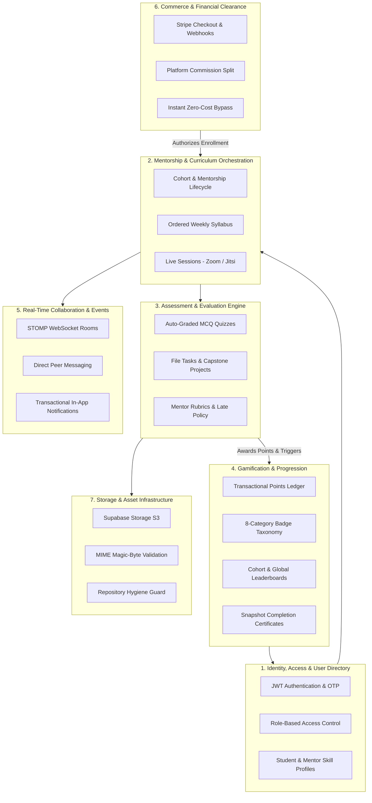
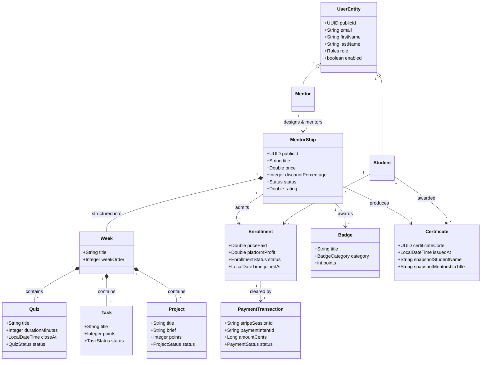

<div align="center">

# 🎓 EduNest Backend
### Enterprise-Grade Mentorship, Structured Learning & Gamified EdTech Ecosystem

[](https://www.oracle.com/java/)
[](https://spring.io/projects/spring-boot)
[](https://spring.io/projects/spring-security)
[](https://www.postgresql.org/)
[](https://github.com/MooRaa86/EduNest/pkgs/container/edunest-backend)
[](#)

*A modular, domain-driven educational platform bridging asynchronous curriculum delivery, cohort-based mentorship, real-time collaboration, and verifiable learning outcomes.*

[Architecture](#-domain-driven-business-architecture) • [Core Domains](#-business-domains--bounded-contexts) • [Domain Model](#-core-domain-model) • [Security & Resilience](#-enterprise-engineering--security-standards) • [Getting Started](#-local-deployment--developer-quickstart)

</div>

---

## 🌟 Executive Overview & Business Value

Traditional online education suffers from a **critical retention and completion crisis (< 10% industry average)** driven by passive pre-recorded video consumption and the absence of human accountability. Conversely, 1-on-1 private tutoring is cost-prohibitive and unscalable.

**EduNest** bridges this gap through a **Scalable Cohort Mentorship Model**. It empowers expert mentors to architect structured, week-by-week learning journeys containing video lectures, auto-evaluated MCQ quizzes, graded capstone projects, live video sessions, and real-time STOMP chat rooms. Learners advance together in cohorts, rewarded by an intrinsic gamification ledger and certified upon completion with tamper-evident database snapshots.

---

## 🏛️ Domain-Driven Business Architecture

EduNest is structured around **7 Autonomous Bounded Contexts (Business Domains)**, enforcing separation of concerns, explicit domain events, and strict transaction boundaries:



---

## 📦 Business Domains & Bounded Contexts

### 1. 🎓 Mentorship & Curriculum Orchestration Domain
* **Mentorship Lifecycle Management:** Mentors design, publish, and supervise comprehensive learning programs transitioning through structured states (`DRAFT` → `ACTIVE` → `COMPLETED`).
* **Ordered Weekly Syllabi:** Curricula are decomposed into ordered weeks containing asynchronous video lectures, instructional resources, and evaluation gates.
* **Synchronous Live Sessions:** Automated scheduling and lifecycle management for live cohorts, featuring integrated Zoom meeting creation with resilient Jitsi fallback routing.
* **Enrollment Registry:** Manages cohort rosters, capacity controls, seat allocation, and student progression states.

### 2. 📝 Assessment & Submission Evaluation Domain
* **Auto-Graded MCQ Quizzes:** Time-bounded interactive evaluations with randomized answer permutations, immediate automated grading, and scheduled automated sweep transitions (`PUBLISHED` → `CLOSED`).
* **Capstone Projects & Tasks:** Deep practical assignments requiring artifact submissions with deadline enforcement, grace windows, and tamper-evident student file attachments.
* **Mentor Evaluation Rubrics:** Mentors review student deliverables, award granular points, and supply structured qualitative feedback through transactional grading workflows.
* **Anti-Cheat & Late Submission Controls:** Fail-closed late grace periods, immutable original submission timestamps, and multi-mentor re-parenting IDOR guards.

### 3. 🏆 Gamification, Progression & Certification Domain
* **Transactional Points Ledger:** Double-entry points tracking ensuring mathematical consistency across quiz completions, task approvals, and badge grants without race conditions.
* **8-Tier Badge Taxonomy:** Dynamic achievements spanning `ACHIEVEMENT`, `PERFORMANCE`, `CONSISTENCY`, `PROBLEM_SOLVING`, `CREATIVITY`, `LEADERSHIP`, `COMMUNITY`, and `SPECIAL_RECOGNITION`.
* **Cohort & Global Leaderboards:** Dynamic ranking projections enabling healthy competition within individual mentorships and across the global platform.
* **Verifiable Completion Certification:** Database-backed, immutable snapshot certification generated upon mentorship completion for qualified graduates, establishing verified student credentials.

### 4. 💬 Real-Time Collaboration & Communication Domain
* **STOMP over WebSockets (`/ws/websocket`):** Full-duplex real-time protocol supporting low-latency group discussions and cohort study rooms (`/topic/room/{id}`).
* **Private Direct Messaging:** Authorized 1-on-1 mentorship consultation channels with conversation identity authorization and member-only read guards.
* **Transactional In-App Notifications:** Real-time push alerts for assignment deadlines, grading publication, live session starts, and badge awards.

### 5. 🔐 Identity, Access Management & Security Domain
* **Strict Role-Based Access Control (RBAC):** Distinct functional partitions for `ROLE_STUDENT`, `ROLE_MENTOR`, and `ROLE_ADMIN`.
* **Stateless JWT Architecture:** Cryptographically signed tokens with automated secret rotation discipline, token blacklisting, and server-side session invalidation.
* **Secure Registration & OTP Flow:** Email verification, brute-force throttling, and single-purpose password reset tokens.
* **Administrative Governance:** Platform-wide oversight via `AdminUserDirectory`, contact-us message resolution flows, and system health observability.

### 6. 💳 Financials, Billing & Commerce Domain
* **Server-Computed Stripe Checkout:** Transparent transaction initiation calculating mentorship price, dynamic discounts, and platform commission.
* **Signature-Verified Webhook Engine:** Fail-closed HMAC signature verification on `POST /api/v1/payments/webhook`, guaranteeing idempotent, exactly-once enrollment clearance.
* **Zero-Cost Free-Tier Bypass:** Dedicated bypass logic allowing immediate enrollment into free mentorships without routing through external payment gateways.

### 7. 🗄️ File Storage & Asset Security Domain
* **S3-Compatible Object Storage:** Cloud file hosting powered by Supabase Storage S3 buckets (`edunest-public` / `edunest-private`).
* **Deep Magic-Byte Inspection:** File validation using Apache Tika to eliminate file extension spoofing, MIME confusion, and executable upload vulnerabilities.
* **Repository Hygiene Gate:** Fail-closed CI gate (`repo-hygiene-gate.sh`) rejecting any tracked user uploads or binary payloads in Git history.

---

## 📊 Core Domain Model



---

## 🛡️ Enterprise Engineering & Security Standards

The EduNest backend is engineered according to enterprise safety doctrines and non-negotiable operational invariants:

| Engineering Standard | Implementation Detail & Evidence |
| :--- | :--- |
| **Strict Forward-Only Database Migrations** | 13 versioned SQL scripts managed via **Flyway**; `ddl-auto=validate` active in production; zero in-app runtime schema mutations. |
| **Fail-Closed API Security Doctrine** | All unexpected runtime exceptions map to sanitized `500 ERR_INTERNAL_SYSTEM` envelopes with correlated tracking `refId`s (zero stack-trace leakage). |
| **Bounded Pagination & DoS Prevention** | Global `PaginationPolicy` clamping `page` ($\ge 0$) and `size` ($1 \le \text{size} \le 50$) with strict `400 ERR_VALIDATION` on malformed inputs (`EB-58`). |
| **Environment Parity & Serialization Guard** | `fail-on-unknown-properties=true` enforced uniformly across all profiles to reject unexpected payload fields with `400 ERR_UNKNOWN_FIELD` (`EB-63`). |
| **WebSocket Room Boundary Authorization** | Handshake CONNECT authenticated via raw JWT; room SUBSCRIBE and SEND operations validated against cohort membership rows (`ChatAuthorization`). |
| **Zero-PII Storage Discipline** | User uploads strictly stored on private S3 buckets with ephemeral pre-signed access; zero local disk reliance. |

---

## 🚀 Local Deployment & Developer Quickstart

### Prerequisites
- **Java Development Kit (JDK 21)** (Temurin recommended)
- **Maven 3.9+**
- **Docker Desktop** (for containerized execution)

### Option A: Running with Docker Compose (Recommended for Frontend & Rapid Evaluation)
EduNest provides an out-of-the-box local orchestration environment pulling the latest public container image from GitHub Container Registry (GHCR):

1. **Clone the repository:**
   ```bash
   git clone https://github.com/MooRaa86/EduNest.git
   cd EduNest
   ```
2. **Start the pre-built backend:**
   ```bash
   docker compose up -d
   ```
3. **Verify running status:**
   ```bash
   curl http://localhost:8080/actuator/health
   # Returns: {"status":"UP"}
   ```

### Option B: Running from Source (Backend Development)
1. **Configure Environment Variables:**
   Create an `.env` or populate your session with the necessary connection credentials:
   ```bash
   export SPRING_PROFILES_ACTIVE=dev
   export DATABASE_URL="jdbc:postgresql://<HOST>:5432/<DB>?sslmode=verify-full"
   export DATABASE_NAME="<DB_USER>"
   export DATABASE_PASSWORD="<DB_PASSWORD>"
   export JWT_SECRET="<MIN_256_BIT_HEX_OR_BASE64_SECRET>"
   ```
2. **Build and Run Test Suite:**
   ```bash
   ./mvnw clean test
   ```
3. **Launch Spring Boot Application:**
   ```bash
   ./mvnw spring-boot:run
   ```

---

## 📡 Essential Platform Endpoints

| Resource | Protocol & Route | Access Level | Description |
| :--- | :--- | :--- | :--- |
| **System Health** | `GET /actuator/health` | Public | Real-time liveness and readiness probe status |
| **Interactive API Docs** | `GET /swagger-ui/index.html` | Public | OpenAPI 3 Swagger specification and test sandbox |
| **Root Gateway Showcase** | `GET /` | Public | In-memory cached system showcase and status metadata |
| **WebSocket STOMP** | `WS /ws/websocket` | Authenticated | Live full-duplex socket for group and direct chat |
| **Stripe Webhook** | `POST /api/v1/payments/webhook` | Public (Signed) | Idempotent transaction and enrollment clearance |

---

## 📚 Architectural & Operational Runbooks

- [Production Activation & Cutover Readiness](PRODUCTION-ACTIVATION-READINESS.md) — 6-stage release gate, cutover plan, and disaster recovery procedures.
- [Cloud Migration & VPS Runbook](CLOUD-MIGRATION-RUNBOOK.md) — Production deployment guide for Hetzner, Caddy reverse proxy, and Docker.
- [Database Transaction & OSIV Policy](mds/database/transactions-consistency.md) — Read-path optimization, N+1 query elimination, and lazy-loading boundaries.
- [Master Plan & Issue Mapping](plan/ISSUE-MAPPING.md) — Complete traceability between Jira tickets, PRs, and architectural decisions.

---

<div align="center">
<b>EduNest Platform</b> • Engineering Excellence & Architectural Integrity
</div>
