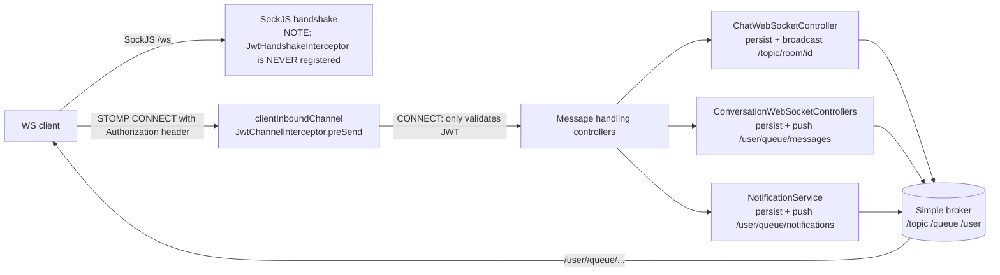
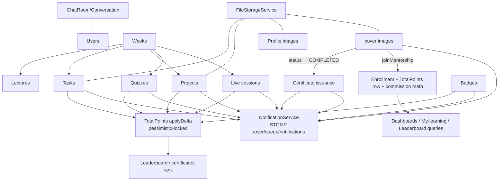

# Architecture — Primary Domain Document

## 1. Overview

EduNest is a **mentor-led structured-learning platform** (Java 21, Spring Boot 3.5.7, MySQL 8) that lets mentors build week-by-week curricula (lectures, quizzes, tasks, capstone projects) for cohorts of enrolled students, with real-time chat, live sessions (Jitsi), gamification (badges/points/leaderboards), PDF-backed recognition artifacts, and an admin console.

**Business value:** bridges passive MOOC-style content and expensive 1:1 mentorship via *scalable group mentorship*, and converts completed learning journeys into verifiable outcomes (certificate, portfolio, public skill profile).

**Scope of this domain:** cross-cutting architecture — the layer/package topology, request pipeline, security pipeline, cross-domain interactions, and design decisions that can be verified in the codebase. Per-feature behavior lives in its own domain directory (see navigation below).

## 2. Main Domains (as derived from the code)

| Domain | Key packages | Primary doc |
|---|---|---|
| Authentication & account | `controller/auth`, `controller/register`, `controller/account`, `service/auth`, `service/jwt`, `service/register`, `filters`, `config/security`, `config/auth` | [../authentication-security/MDS.md](../authentication-security/MDS.md) |
| Security enforcement (cross-cutting) | `config/security`, `filters`, `service/security`, `repository/AuthorizationRepository` | [../authentication-security/authorization-rules.md](../authentication-security/authorization-rules.md) |
| Mentorship lifecycle & enrollment | `controller/mentorShip`, `service/mentorShip`, `entity/mentorship` | [../mentorship-flow/MDS.md](../mentorship-flow/MDS.md) |
| Weeks, lectures, curriculum | `controller/weeks`, `controller/lecture`, `service/week`, `service/lecture` | [../mentorship-flow/weeks-and-lectures.md](../mentorship-flow/weeks-and-lectures.md) |
| Learning content (tasks/projects/quizzes) | `controller/tasks`, `controller/projects`, `controller/quiz`, `service/tasks`, `service/projects`, `service/quiz` | [../learning-content/MDS.md](../learning-content/MDS.md) |
| Users & profiles | `entity/users`, `controller/profile`, `service/profile`, `controller/skill` | [../users-profiles/MDS.md](../users-profiles/MDS.md) |
| Gamification (badges/points) | `service/badges`, `entity/badges`, `entity/points`, `service/points` | [../gamification/MDS.md](../gamification/MDS.md) |
| Live sessions & attendance | `controller/livesession`, `service/livesession`, `entity/livesession` | [../live-sessions/MDS.md](../live-sessions/MDS.md) |
| Real-time chat (WebSocket/STOMP) | `config/webSocket`, `controller/chat`, `service/chat`, `entity/chat` | [../websocket/MDS.md](../websocket/MDS.md) |
| Notifications | `controller/notification`, `service/notification`, `entity/notification` | [../notifications/MDS.md](../notifications/MDS.md) |
| Certificates | `controller/studentCertificates`, `service/certificate`, `entity/certificate` | [../certificates/MDS.md](../certificates/MDS.md) |
| File storage & uploads | `service/fileSotageService` *(sic)*, `controller/file`, `service/mentorShip/ImageStorageService`, `config/WebConfig` | [../file-storage/MDS.md](../file-storage/MDS.md) |
| External integrations (Jitsi, SMTP, Tika, iText) | `service/livesession/JitsiService`, `service/register/EmailService`, `templates/emails/*` | [../integrations/MDS.md](../integrations/MDS.md) |
| Admin & contact-us | `controller/admin`, `service/admin`, `controller/contactus`, `service/contactus` | [../api/endpoints.md](../api/endpoints.md) (endpoints), [../integrations/external-services.md](../integrations/external-services.md#contact-us) |
| Dashboards (mentor/admin) | `controller/MentorDashboard`, `service/dashboard`, `controller/admin` | [../users-profiles/profiles.md](../users-profiles/profiles.md#dashboards) |
| Persistence | `entity/**` (43 entity classes), `repository/**` | [../database/MDS.md](../database/MDS.md) |
| API contracts & errors | `controller/**`, `dto/**`, `exception/**` | [../api/MDS.md](../api/MDS.md) |
| Testing | `src/test` | [../testing/MDS.md](../testing/MDS.md) |
| Build, Docker, CI/CD | `pom.xml`, `Dockerfile`, `.github/workflows` | [../deployment/MDS.md](../deployment/MDS.md) |

## 3. Current Implementation — Topology

### 3.1 Layered architecture (package-per-layer, package-per-domain hybrid)

The root package `com.example.gradproj.EduNest` is organized **hybridly**: top-level packages are classic layers (`controller`, `service`, `repository`, `entity`, `dto`, `config`, `exception`, `enums`, `filters`), and inside each layer sub-packages split by business domain (`controller/mentorShip`, `service/tasks`, `entity/quiz`, …).

```text
com.example.gradproj.EduNest
├── EduNestApplication          (@SpringBootApplication, @EnableScheduling, @EnableAsync)
├── entity/                     43 entity classes, all extend BaseEntity (few exceptions)
├── repository/                 Spring Data JPA interfaces + projection interfaces
├── service/                    business logic (28+ sub-packages); final classes, constructor injection
├── controller/                 33 @RestController classes (REST), 2 STOMP @Controller classes
├── dto/                        request/response records & classes, per-domain sub-packages
├── config/                     security (2 profiles), auth (provider+UDS), websocket, swagger, RolesSeeder
├── filters/                    JwtTokenValidatorFilter, JwtTokenGeneratorFilter (prod only)
├── exception/                  GlobalExceptionHandler + domain exceptions + ErrorResponse envelope
├── enums/                      enum types per domain (lifecycle states, roles, OTP types, …)
├── auditing/                   JpaAuditingConfig + AuditorAwareImpl (auditor = current email)
├── annotation/                 Bean Validation custom constraint (FieldsValueMatch)
├── security/                   CurrentUserProvider (@RequestScope context accessor)
├── utils/, util/               Constants, SystemUtils, FileResponseBuilder (two utility packages)
└── features/roadmap/           EMPTY skeleton packages — unimplemented feature, zero code
```

Verified facts:
- **Roles:** `ADMIN`, `MENTOR`, `STUDENT` seeded by `config/RolesSeeder` (CommandLineRunner, idempotent).
- **User model:** `UserEntity` (JOINED inheritance) → `Student` / `Mentor`; `Admin` is a **separate entity** that does **not** extend `UserEntity` (no `enabled`/`deleted` flags).
- **33 REST controllers** under `controller/**`, plus 2 WebSocket message controllers (`controller/chat/ChatWebSocketController`, `controller/chat/ConversationWebSocketControllers`).
- **Only scheduled job in the app:** `service/register/OtpCleanupService.removeExpiredOtps` (`@Scheduled(fixedRate = 3600000)`). `@Async` is enabled globally (`@EnableAsync`) and used by `EmailService`, `NotificationService` (fan-out sends).
- **`features/roadmap/**` is an empty skeleton** (directories only, zero Java files, zero references) — an unimplemented placeholder feature.

### 3.2 Request pipeline (HTTP)

```mermaid
flowchart LR
  C[Client] -->|HTTPS| P[Prod SecurityFilterChain\nProjectSecurityProdconfig]
  P --> V[JwtTokenValidatorFilter\nvalidates JWT + re-checks enabled/deleted]
  V --> R[DispatcherServlet]
  R --> H[@PreAuthorize method guard]
  H --> S[Service layer\nobject-level checks via SecurityService/\nAuthorizationRepository/CurrentUserProvider]
  S --> D[Spring Data JPA repositories]
  D --> DB[(MySQL 8)]
  D --> FS[(uploads/ on disk)]
  S -.async.-> M[SMTP via EmailService @Async]
  S -.push.-> W[STOMP broker push\nNotificationService/ChatMessageService]
```

- In `prod` profile only: stateless session policy, CSRF disabled, JWT filter chain, custom `AuthenticationEntryPoint` (401) and `AccessDeniedHandler` (403) returning JSON.
- In the **`!prod` (dev) profile** the chain is `anyRequest().permitAll()` — see [security-risks](../authentication-security/security-risks.md).
- Two different security `SecurityFilterChain` beans coexist: `config/security/ProjectSecurityConfig` (`@Profile("!prod")`) and `ProjectSecurityProdconfig` (`@Profile("prod")`).

### 3.3 Real-time pipeline (WebSocket/STOMP over SockJS)



Critical architectural fact: **room-membership authorization on STOMP SUBSCRIBE and SEND is commented out** in `config/webSocket/JwtChannelInterceptor` (lines 87–105 and 130–140); the handshake interceptor is dead code. Any authenticated user can eavesdrop on or write to any room — see [websocket/connection-lifecycle.md](../websocket/connection-lifecycle.md) and [../ISSUES.md](../ISSUES.md).

### 3.4 Persistence pipeline

- Hibernate `ddl-auto=update` in **all profiles** (no migrations tool), `show-sql=true` even in prod (`src/main/resources/application.properties`, `application-prod.properties`).
- All entities inherit creation/update timestamps and auditor columns from `entity/BaseEntity` (`@CreationTimestamp`, `@UpdateTimestamp`, `@CreatedBy`/`@LastModifiedBy` via `auditing/JpaAuditingConfig` — auditor resolves to the current user email or `SYSTEM`).
- A few entities bypass `BaseEntity`: `entity/chat/Message`, `entity/chat/Conversation`, `entity/chat/ChatRoomMember`, `entity/skill/StudentSkill`, `entity/Roles` (plain `@Id`; no audit columns). Consequence: private-chat messages have **no** `updatedAt` (edits lose edit timestamp) and `Conversation` rows get no DB-managed timestamps beyond the annotated `@CreationTimestamp` on `createdAt`.
- Detailed model, transactions, and consistency risks: [../database/MDS.md](../database/MDS.md).

## 4. Architecture & Dependencies

### 4.1 External dependencies (runtime)

| Concern | Library / service | Where | Notes |
|---|---|---|---|
| Auth | Spring Security 6 + jjwt 0.12.5 (HS256) | `service/jwt`, `filters/*` | secret from `JWT_SECRET` env **with hardcoded fallback** — see [../ISSUES.md](../ISSUES.md) SEL-01 |
| DB | MySQL 8 (mysql-connector-j 8.0.33), Spring Data JPA / Hibernate | `application*.properties` | all connection params via env vars |
| Real-time | spring-boot-starter-websocket (STOMP + SockJS simple broker) | `config/webSocket` | no Redis/external broker — **single-node in-memory broker** |
| Mail | spring-boot-starter-mail (SMTP, STARTTLS) | `service/register/EmailService` | config via `MAIL_*` env vars |
| File type validation | Apache Tika 2.9.2 | `service/fileSotageService/FileStorageService` | used for submission files only; **not** for mentorship covers/profile images |
| PDF | iText7 7.2.5 | **only** `service/admin/BadgePdfGeneratorService` | certificates are **not** PDF-generated despite README claims — see [../certificates/MDS.md](../certificates/MDS.md) |
| Live sessions | Jitsi Meet (public `https://meet.jit.si`) | `service/livesession/JitsiService` | **no JWT/token/secret** — plain public room URL |
| Docs | springdoc-openapi 2.7.0 | `config/swagger/OpenApiConfig` | Swagger UI permitted anonymously **including prod** |
| Templates | Thymeleaf starter + `templates/emails/*.html` | `EmailService` | 10 email templates |

### 4.2 Internal coupling / domain-interaction map



Key design-relevant interactions:
- **Points are the backbone of outcomes**: enrollment creates a `TotalPoints` row; task/project/quiz/badge/attendance events mutate it (pessimistic-locked); leaderboard feeds the mentorship dashboard **and** certificate ranks.
- **Certificate issuance** is triggered inside the mentorship status-transition transaction (`mentorShipServiceI.updateMentorShipStatus`) and depends on the full leaderboard query.
- **Notifications** are persisted then pushed over STOMP from inside the caller's transaction (push-before-commit pattern; see [../notifications/MDS.md](../notifications/MDS.md)).

## 5. Workflows & Data Flow

Canonical step-by-step flows are documented per domain:
- Registration → OTP → login overview: [../authentication-security/authentication-flow.md](../authentication-security/authentication-flow.md)
- Mentorship create → publish → complete → certificate: [../mentorship-flow/mentorship-lifecycle.md](../mentorship-flow/mentorship-lifecycle.md)
- Task create → submit → grade → points: [../learning-content/tasks-workflow.md](../learning-content/tasks-workflow.md)
- Quiz open → attempt → auto-grade → points: [../learning-content/quizzes-workflow.md](../learning-content/quizzes-workflow.md)
- Session create → start → join → snapshot → end → attendance points: [../live-sessions/MDS.md](../live-sessions/MDS.md)

## 6. Design Decisions (verified, as-built)

| Decision | Evidence | Consequence |
|---|---|---|
| Stateless JWT auth, no refresh/logout server-side | `service/jwt/JwtService`, `ProjectSecurityProdconfig` (STATELESS) | 7-day tokens, role changes require re-login — [../authentication-security/MDS.md](../authentication-security/MDS.md) |
| Two profile-split security configs instead of one | `ProjectSecurityConfig` (`!prod`) vs `ProjectSecurityProdconfig` | dev build is wide open; risk of running without `prod` |
| JOINED-table inheritance for users | `entity/users/UserEntity` (`@Inheritance(JOINED)`) | normalized but every user query joins base + subtype |
| Denormalized `platformProfit` + `price` snapshot on `Enrollment` | `entity/mentorship/Enrollment`, `CommissionService` | commission locked at join time; admin rate updates don't reprice history |
| Denormalized sender email/name on each chat message | `entity/chat/ChatMessage` | fast reads, stale display names |
| Shared `Notification` row + per-user relation row | `entity/notification/*` | single fan-out row, `is_read` on relation |
| Points stored per-mentorship in `TotalPoints`, locked updates | `entity/points/TotalPoints`, `TotalPointsServiceImp` | race-safe per-mentorship totals; no cross-mentorship aggregate exists |
| File access by path within local `uploads/` directory | `FileStorageService`, `WebConfig`, static-locations | filesystem-coupled; **no volume in Docker** — data loss on redeploy |
| DTO envelope `SimpleResponse{status, value…}` across many endpoints | `dto/SimpleResponse` + controllers | loose contract shape, mostly stringly maps |
| Validator layer = service-embedded ownership checks + `AuthorizationRepository` existence queries | `service/security/SecurityService`, `repository/AuthorizationRepository` | works, but usage is **uneven across services** (IDOR debt documented in the legacy audit) |

## 7. Known Issues (cross-cutting, summary)

The consolidated, fully-detailed inventory with IDs, severity, and evidence lives in [../ISSUES.md](../ISSUES.md). Cross-cutting highlights:

- **ARCH-001 (TECHNICAL DEBT, Confirmed):** the **dev security profile grants `anyRequest().permitAll()`** (`config/security/ProjectSecurityConfig.java:53`) — running the default profile exposes the entire API including admin endpoints.
- **ARCH-002 (SECURITY, Confirmed):** WebSocket surface is effectively unguarded (`JwtChannelInterceptor` membership checks commented out; `JwtHandshakeInterceptor` never registered).
- **ARCH-003 (TECHNICAL DEBT, Confirmed):** hardcoded JWT secret fallback in `utils/Constants.java:5` and a **secret-resolution mismatch** in `service/auth/LoginServiceI#getJwtRole` (hardcodes the fallback even when `JWT_SECRET` env is set).
- **ARCH-004 (RELIABILITY, Confirmed):** in-memory STOMP broker + single `@Scheduled` job only; no session auto-lifecycle, no quiz auto-close, no file cleanup.
- **ARCH-005 (TECHNICAL DEBT, Confirmed):** two utility packages `utils` and `util` with overlapping purpose; naming inversions (`LoginService` is the interface, `LoginServiceI` the impl); lowercase controller class names (`chatRestControllers`).
- **ARCH-006 (DOCUMENTATION, Confirmed):** README and the graduation books claim behaviors that do not exist in code (Jitsi JWT auth, iText PDF certificates) — documented in [../certificates/MDS.md](../certificates/MDS.md) and [../integrations/MDS.md](../integrations/MDS.md).
- **ARCH-007 (TECHNICAL DEBT, Confirmed):** `features/roadmap/**` is an empty skeleton with no code or references (verified via glob + grep + git).

## 8. Open Questions & Assumptions

- **Q1:** Is the single-node, in-memory broker acceptable for production, or is Redis/multi-instance horizontally-scaled deployment planned? (Blocking decision for sticky sessions/broker changes.)
- **Q2:** Which deployment profile is canonical — the Dockerfile forces `prod`, but local runs default to the wide-open `!prod` chain. Confirm whether the `!prod` chain is ever intended to face real traffic.
- **Q3:** Is `features/roadmap` a planned feature awaiting implementation? Recommend deleting the skeleton or implementing it as a proper bounded-context package.
- **Q4:** The undocumented-but-real method-level authorization model (`@PreAuthorize` + service checks) — confirm the team wants to keep the *uneven* current coverage as baseline or standardize per endpoint matrix (proposed standardization is a recommendation, not implemented behavior).

## 9. Related Documentation

- [system-overview.md](system-overview.md) — package map, pipeline details, cross-cutting conventions
- [../ISSUES.md](../ISSUES.md) — consolidated issue inventory (this document's ARCH-* IDs are defined there)
- [../api/MDS.md](../api/MDS.md) — API surface conventions and error contract
- [../database/MDS.md](../database/MDS.md) — persistence model
- [../deployment/MDS.md](../deployment/MDS.md) — build/Docker/CI reality
