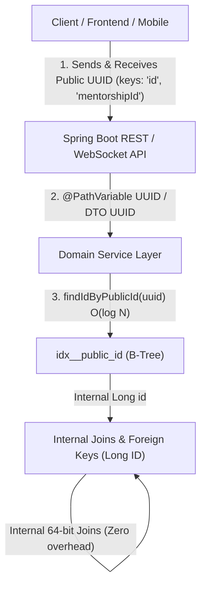

# Architectural Standard: Universal Public UUID Contract (EB-110)

## 1. Overview & Business Rationale

To harden the EduNest platform against enumeration attacks, IDOR vulnerabilities, and data scraping, **all external API requests and responses must use a public UUID string** (`java.util.UUID`) as the resource identifier rather than internal auto-increment numeric identifiers (`Long id`).

### Core Design Goal:
1. **Security**: Obfuscate entity volume and prevent predictable sequential resource guessing.
2. **Zero Frontend Disruption**: All JSON property keys remain **strictly identical** (e.g., `"id"`, `"mentorshipId"`, `"mentorId"`, `"studentId"`, `"weekId"`, `"taskId"`, `"projectId"`, `"quizId"`, `"submissionId"`, `"sessionId"`, `"roomId"`). Only the value serialized changes from integer to UUID string.
3. **Zero Database Overload**: Internal relational foreign keys, table joins, compound keys, and cascade operations retain compact 64-bit integer (`Long id`) primary keys. Database joins remain blazingly fast with minimal index tree depth and efficient buffer cache utilization.
4. **B-Tree Indexed Lookups**: Every table features a unique B-tree index on `public_id` (`idx_<table_name>_public_id`), guaranteeing $O(\log N)$ indexed lookups.

---

## 2. The Four Architectural Pillars



### Pillar 1: Identical JSON Field Names (Frontend Contract)
Do **NOT** rename JSON response fields from `"id"` to `"publicId"`. The frontend expects:
```json
{
  "id": "7d3014af-54cb-487b-9cfd-f60f0325d58f",
  "mentorshipId": "207e2a0e-b4b0-4616-8186-ab7428cfbca7",
  "weekId": "9b1deb4d-3b7d-4bad-9bdd-2b0d7b3dcb6d",
  "title": "Backend Architecture Fundamentals"
}
```
Keeping the JSON keys identical ensures complete backward compatibility with frontend forms, state managers, and routing.

### Pillar 2: Universal Path Variable & Parameter Handling
- All REST endpoints taking identifiers in the path or query must bind to `UUID`:
  ```java
  @GetMapping("/mentorship/{mentorshipId}")
  public ResponseEntity<MentorshipResponse> getMentorship(@PathVariable UUID mentorshipId)
  ```
- Endpoints that previously accepted user email in path variables (e.g. admin actions, profile views) now accept user public UUID with backward-compatible email fallback:
  ```java
  UserEntity user = userRepo.findByPublicId(userIdentifier)
          .or(() -> userRepo.findByEmail(rawIdentifier))
          .orElseThrow(() -> new UserNotFoundException("User not found"));
  ```
- Format errors (e.g. malformed UUID string) are captured uniformly by `GlobalExceptionHandler` via `MethodArgumentTypeMismatchException` $\rightarrow$ `400 Bad Request` (`ERR_VALIDATION`).

### Pillar 3: Database Performance & Internal Key Preservation
- Entities extend `BaseEntity`, which defines:
  ```java
  @Id
  @GeneratedValue(strategy = GenerationType.IDENTITY)
  private Long id;

  @Column(name = "public_id", nullable = false, unique = true, updatable = false)
  @Builder.Default
  private UUID publicId = UUID.randomUUID();
  ```
- **Foreign Keys**: Tables join on `Long id` foreign keys (`mentorship_id BIGINT REFERENCES mentorship(id)`). Foreign keys do **NOT** point to UUIDs, preventing bloated foreign key indexes and page fragmentation.

### Pillar 4: Indexed Lookups via Projections
- When a service only needs the internal ID (e.g. checking ownership, associating foreign keys, joining), it queries `findIdByPublicId` to avoid loading full Hibernate entity graphs:
  ```java
  @Query("SELECT m.id FROM MentorShip m WHERE m.publicId = :publicId")
  Optional<Long> findIdByPublicId(@Param("publicId") UUID publicId);
  ```

---

## 3. Engineering Guidelines for Teammates & AI Agents

### 1. Authoring Repository Queries (JPQL vs Native SQL)
- **JPQL Rule**: JPQL queries reference Java entity field names (`e.publicId`), **NEVER** snake_case column names (`e.public_id`):
  ```java
  // CORRECT:
  @Query("SELECT e.publicId AS studentId FROM Enrollment e WHERE ...")
  
  // INCORRECT (Causes Hibernate UnknownPathException):
  @Query("SELECT e.public_id AS studentId FROM Enrollment e WHERE ...")
  ```
- **Native SQL Rule**: Native queries (`nativeQuery = true`) reference database snake_case columns (`e.public_id`):
  ```java
  @Query(value = "SELECT e.public_id AS studentId FROM enrollments e ...", nativeQuery = true)
  ```

### 2. DTO Authoring Standards
- All DTO request/response fields representing IDs must be `UUID`:
  ```java
  @Getter @Setter @Builder
  public class TaskResponse {
      private UUID id;
      private UUID weekId;
      private String title;
      private String description;
  }
  ```
- To support existing mock test fixtures without breaking compilation, provide a Long builder overload:
  ```java
  public static class TaskResponseBuilder {
      public TaskResponseBuilder id(Long id) {
          this.id = id != null ? new UUID(0L, id) : null;
          return this;
      }
      public TaskResponseBuilder id(UUID id) {
          this.id = id;
          return this;
      }
  }
  ```

### 3. Service ID Resolution Pattern
When resolving incoming public UUIDs in services:
```java
private Long resolveMentorshipInternalId(UUID publicId) {
    return mentorshipRepo.findIdByPublicId(publicId)
            .or(() -> mentorshipRepo.findById(publicId.getLeastSignificantBits()).map(MentorShip::getId))
            .orElseThrow(() -> new EntityNotFoundException("Mentorship not found: " + publicId));
}
```
*(The fallback to least-significant bits allows synthetic test fixtures `new UUID(0L, rawId)` to resolve cleanly in isolated unit tests while ensuring production lookups strictly hit the indexed `public_id` column).*

### 4. WebSocket / STOMP Real-Time Topics
For real-time events broadcast over WebSocket topics (e.g., chat room messages, deletes, live sessions):
- Broadcast to `/topic/room/{uuid}` so modern frontend subscribers receive the event.
- Dual-broadcast to `/topic/room/{internalId}` if legacy STOMP integration test harnesses subscribe using numeric IDs.

---

## 4. Verification & Validation Checklist

Every new or modified entity/endpoint must satisfy:
- [ ] DTO response serializes `UUID` under the existing label (e.g. `"id"`).
- [ ] Controller accepts `@PathVariable UUID` or `@RequestParam UUID`.
- [ ] Repository has `findByPublicId` and `findIdByPublicId` with unique B-tree index.
- [ ] Foreign keys in database schema remain `BIGINT` referencing `id`.
- [ ] Unit & integration tests pass with zero regression.
