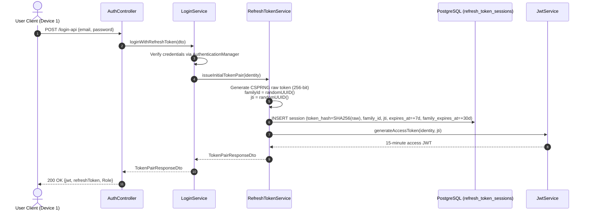
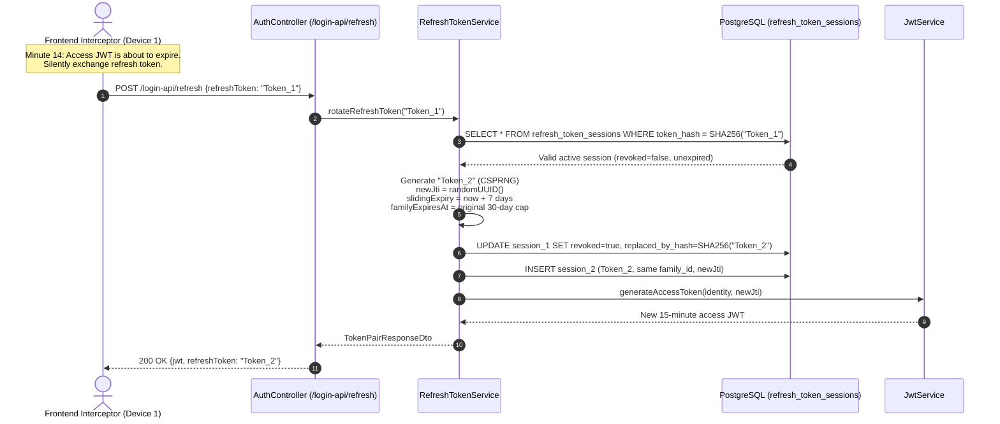
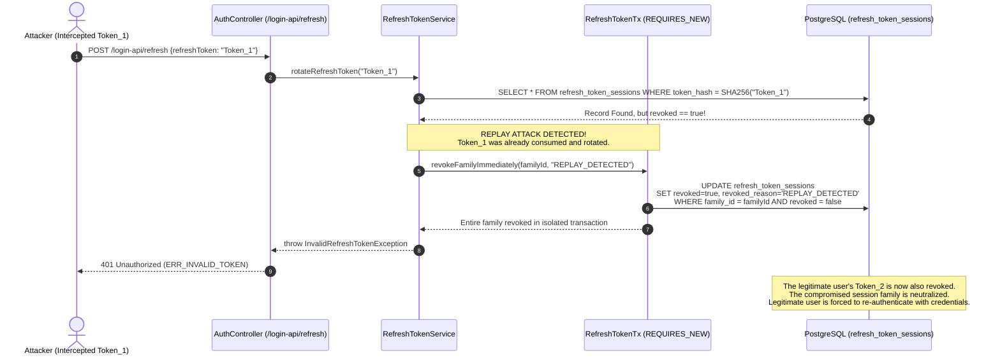

# Secure Refresh Token Rotation & Session Revocation (EB-91 / D-01 / SEL-06)

This document specifies the technical architecture, cryptographic design, database schema, and operational lifecycle flows for the **EduNest Refresh Token Rotation and Session Revocation subsystem** implemented under ticket **EB-91 (Decision D-01 / SEL-06)**.

---

## 1. Architectural Overview & Design Decisions

Prior to EB-91, authentication in EduNest relied solely on long-lived, 7-day stateless access JWTs without server-side revocation or refresh capabilities. EB-91 transitions the platform to a defense-in-depth, dual-token security model with strict token rotation and session control.

### 1.1 Dual-Token Characteristics

| Parameter | Access Token (JWT) | Refresh Token (Opaque CSPRNG) |
| :--- | :--- | :--- |
| **Token Type** | Signed JWT (HMAC-SHA256) | 256-bit cryptographically secure random string |
| **Encoding** | Compact URL-safe JWT (`header.payload.signature`) | Base64URL string (32 raw entropy bytes) |
| **Validity Period** | **15 minutes** (`JwtService.EXPIRATION_TIME_MS`) | **7 days sliding TTL**, capped at **30 days absolute TTL** |
| **Server State** | **100% Stateless** (Option A: zero database queries) | Persistent session entity (`refresh_token_sessions`) |
| **Database Storage** | Never stored | **SHA-256 Hex Digest only** (`token_hash`) |
| **Dual Identifier** | Carries account `userId` (public UUID), `ownerType`, `ownerId` | Session entity extends `BaseEntity` (BIGINT `id` PK + `public_id` UUID) |
| **Rotation Policy**| Re-issued on each refresh | **Single-use (RTR)**: rotated and revoked on every consumption |

### 1.2 Architectural Directives

1. **Option A Stateless Logout Directive**:
   - Access JWTs are short-lived (15 minutes) and expire naturally upon logout.
   - `JwtTokenValidatorFilter` remains **100% stateless**. It verifies signature and account enabled/deleted status without querying the database for `jti` or session validity on normal requests.
   - Database lookups on `refresh_token_sessions` occur strictly on `/login-api/refresh`, `/login-api/logout`, and `/login-api/logout-all`.
2. **Flyway Out-of-Order Migration**:
   - V5 (`V5__refresh_token_sessions.sql`) was backfilled after V6 (`V6__add_public_uuid_identifiers.sql`) was already merged into `main`.
   - Enabled `spring.flyway.out-of-order=true` in `application.properties` and `application-prod.properties` to ensure clean historical execution.
3. **Dual Identifier Pattern**:
   - Internal foreign keys and primary keys utilize `BIGINT` to maintain high-performance B-tree indexing in PostgreSQL.
   - External exposures use cryptographically random `UUID` (`public_id`) to prevent Insecure Direct Object References (IDOR).
4. **Token Family Grouping & Replay Attack Defense**:
   - Each initial login creates a new `family_id` (UUID).
   - Every rotation step inherits the `family_id` and records the parent-child linkage via `replaced_by_hash`.
   - If an already-rotated or revoked token is presented, the system detects a replay attack and revokes the **entire family** immediately via an isolated transaction (`@Transactional(propagation = Propagation.REQUIRES_NEW)` in `RefreshTokenTx`).

---

## 2. Database Schema & Entity Model

### 2.1 Table Definition (`refresh_token_sessions`)

Created in `src/main/resources/db/migration/V5__refresh_token_sessions.sql`:

```sql
CREATE EXTENSION IF NOT EXISTS pgcrypto;

CREATE TABLE IF NOT EXISTS refresh_token_sessions (
    id BIGINT GENERATED BY DEFAULT AS IDENTITY PRIMARY KEY,
    public_id UUID DEFAULT gen_random_uuid() NOT NULL,
    family_id VARCHAR(64) NOT NULL,
    token_hash VARCHAR(64) NOT NULL,
    access_token_jti VARCHAR(64),
    user_id BIGINT REFERENCES users(id) ON DELETE CASCADE,
    admin_id BIGINT REFERENCES admin(id) ON DELETE CASCADE,
    expires_at timestamp(6) NOT NULL,
    family_expires_at timestamp(6) NOT NULL,
    revoked BOOLEAN NOT NULL DEFAULT false,
    revoked_at timestamp(6),
    revoked_reason VARCHAR(64),
    replaced_by_hash VARCHAR(64),
    created_at timestamp(6) NOT NULL DEFAULT now(),
    updated_at timestamp(6) NOT NULL DEFAULT now(),
    created_by VARCHAR(255) NOT NULL DEFAULT 'SYSTEM',
    updated_by VARCHAR(255) NOT NULL DEFAULT 'SYSTEM',
    CONSTRAINT chk_rts_exactly_one_owner CHECK (
        (user_id IS NOT NULL AND admin_id IS NULL) OR
        (user_id IS NULL AND admin_id IS NOT NULL)
    )
);

CREATE UNIQUE INDEX IF NOT EXISTS idx_rts_token_hash ON refresh_token_sessions(token_hash);
CREATE UNIQUE INDEX IF NOT EXISTS idx_rts_public_id ON refresh_token_sessions(public_id);
CREATE INDEX IF NOT EXISTS idx_rts_family_id ON refresh_token_sessions(family_id);
CREATE INDEX IF NOT EXISTS idx_rts_access_token_jti ON refresh_token_sessions(access_token_jti);
CREATE INDEX IF NOT EXISTS idx_rts_user_id ON refresh_token_sessions(user_id);
CREATE INDEX IF NOT EXISTS idx_rts_admin_id ON refresh_token_sessions(admin_id);
CREATE INDEX IF NOT EXISTS idx_rts_expires_at ON refresh_token_sessions(expires_at);
```

### 2.2 Entity Mapping (`RefreshTokenSession.java`)

Located in `com.example.gradproj.EduNest.entity.auth.RefreshTokenSession`:
- Extends `BaseEntity` (inheriting `id`, `public_id`, `created_at`, `updated_at`, `created_by`, `updated_by`).
- Maps `UserEntity user` and `Admin admin` with exactly one owner.
- Helper method `isExpired(LocalDateTime now)` checks both sliding (`now.isAfter(expiresAt)`) and absolute (`now.isAfter(familyExpiresAt)`) limits.

---

## 3. Cryptographic Operations (`RefreshTokenCryptoUtil`)

Located in `com.example.gradproj.EduNest.service.auth.RefreshTokenCryptoUtil`:
1. **Raw Token Generation**:
   - Uses `SecureRandom` to generate 32 bytes (256 bits) of cryptographic entropy.
   - Encodes via `Base64.getUrlEncoder().withoutPadding()`.
2. **Token Hashing**:
   - Computes `SHA-256` digest of the raw string.
   - Formats digest as a lowercase 64-character hexadecimal string.
   - Raw tokens are returned to the client and never stored; the database only indexes `token_hash`.

---

## 4. API Endpoints

All endpoints are registered in `com.example.gradproj.EduNest.controller.auth.AuthController`:

### 4.1 Login: `POST /login-api`
- **Access**: Public (rate limited).
- **Request Body**: `LoginRequestDto` (`email`, `password`).
- **Response Body**:
  ```json
  {
    "apiResponse": {
      "status": "Login successful",
      "jwt": "eyJhbGciOi...",
      "refreshToken": "vK7_r9xQ...",
      "Role": "ROLE_STUDENT"
    }
  }
  ```
- **Response Headers**: `Authorization: eyJhbGciOi...`

### 4.2 Refresh Token Rotation: `POST /login-api/refresh`
- **Access**: Public (`PublicRoutesPolicy`), rate limited via `AuthRateLimitFilter.REFRESH`.
- **Request Body**:
  ```json
  {
    "refreshToken": "vK7_r9xQ..."
  }
  ```
- **Response Body**:
  ```json
  {
    "apiResponse": {
      "status": "Token rotated successfully",
      "jwt": "eyJhbGciOi...",
      "refreshToken": "mP3_b8tL...",
      "Role": "ROLE_STUDENT"
    }
  }
  ```
- **Error Responses**:
  - `401 Unauthorized` (`ERR_INVALID_TOKEN`): Token invalid, expired, or replayed.

### 4.3 Single Session Logout: `POST /login-api/logout`
- **Access**: Public (`PublicRoutesPolicy`).
- **Request Body**:
  ```json
  {
    "refreshToken": "mP3_b8tL..."
  }
  ```
- **Response Body**:
  ```json
  {
    "apiResponse": {
      "status": "Logout successful"
    }
  }
  ```
- **Action**: Marks the matching refresh session `revoked = true` (`revoked_reason = 'USER_LOGOUT'`). Other devices/families remain unaffected.

### 4.4 Global Multi-Device Logout: `POST /login-api/logout-all`
- **Access**: Authenticated (Requires valid JWT in `Authorization` header).
- **Header**: `Authorization: Bearer <access-token>` or raw `<access-token>`.
- **Response Body**:
  ```json
  {
    "apiResponse": {
      "status": "All sessions logged out successfully"
    }
  }
  ```
- **Action**: Extracts `access_token_jti`, verifies session binding, extracts `ownerType` and `ownerId`, and revokes **all** refresh token sessions for that account across all devices and families (`revoked_reason = 'LOGOUT_ALL'`).

---

## 5. Event-Driven Security Invalidation Hooks

To prevent unauthorized access across all devices when sensitive account changes occur, `RefreshTokenService.revokeAllForUser` and `revokeAllForAdmin` are hooked directly into key lifecycle events:

1. **User Password Change**:
   - Class: `com.example.gradproj.EduNest.service.account.SettingsService.changePassword`
   - Action: Hashes new password, saves entity, and invokes `refreshTokenService.revokeAllForUser(user.getId())`.
2. **User Account Deactivation**:
   - Class: `com.example.gradproj.EduNest.service.account.SettingsService.deactivateAccount`
   - Action: Sets `enabled = false`, saves entity, clears SecurityContext, and invokes `refreshTokenService.revokeAllForUser(user.getId())`.
3. **Password Reset Completion via OTP**:
   - Class: `com.example.gradproj.EduNest.service.register.RegisterServiceImpl.resetPassword`
   - Action: Verifies reset token, sets new password, deletes OTP, and invokes `refreshTokenService.revokeAllForUser(user.getId())`.
4. **Admin Password Change**:
   - Class: `com.example.gradproj.EduNest.service.admin.AdminProfileAndSettingsService.changePassword`
   - Action: Hashes new password, saves entity, and invokes `refreshTokenService.revokeAllForAdmin(admin.getId())`.

---

## 6. Daily Scheduled Cleanup (`RefreshTokenCleanupService`)

Located in `com.example.gradproj.EduNest.service.auth.RefreshTokenCleanupService`:
- Runs daily at midnight UTC (`@Scheduled(cron = "0 0 0 * * ?")`).
- Purges sessions where `expires_at < now` OR `family_expires_at < now`.
- Prevents unbounded growth of the `refresh_token_sessions` table.

---

## 7. Real User Case Workflows & Sequence Diagrams

### 7.1 Initial Login (Issuing Token Pair)



### 7.2 Seamless Background Token Rotation



### 7.3 Replay Attack Detection & Family Annihilation



### 7.4 Multi-Device Isolation

1. **Independent Families**: When a user logs in on a phone (Device 2) while maintaining a laptop session (Device 1), the server allocates a new `family_id` (`F2`) for Device 2.
2. **Isolated Rotation**: Rotations on Device 1 only affect `family_id = F1`. Rotations on Device 2 only affect `family_id = F2`.
3. **Targeted Revocation**: A replay attack on Device 1 revokes only `F1`; Device 2 remains securely logged in.
4. **Global Revocation**: Calling `POST /login-api/logout-all` wipes both `F1` and `F2` simultaneously.

---

## 8. Verification Matrix & Probe Test Coverage

All contracts are covered by automated integration tests:

| Test Name | File | Assertion |
| :--- | :--- | :--- |
| `loginIssuesBothAccessAndRefreshToken` | `RefreshTokenIntegrationTest` | `/login-api` returns valid JWT, opaque refresh token, and stores SHA-256 hash in DB. |
| `rotateRefreshTokenIssuesNewPairAndInvalidatesOld` | `RefreshTokenIntegrationTest` | `/login-api/refresh` issues new pair, marks old session replaced and revoked. |
| `replayAttackTriggersFamilyWideRevocation` | `RefreshTokenIntegrationTest` | Reusing old refresh token revokes entire family; subsequent child tokens fail with 401. |
| `singleSessionLogoutRevokesOnlySpecificSession` | `RefreshTokenIntegrationTest` | `/login-api/logout` revokes current family; second device session continues to rotate cleanly. |
| `logoutAllRevokesAllSessionsAcrossFamilies` | `RefreshTokenIntegrationTest` | `/login-api/logout-all` revokes all active families for that user across devices. |
| `deactivatedOrDeletedUserCannotRotateTokens` | `RefreshTokenIntegrationTest` | Disabled/deleted users are rejected with 401 on refresh attempts. |
| `passwordResetRevokesAllExistingRefreshTokens` | `RefreshTokenIntegrationTest` | Completing OTP password reset revokes all outstanding refresh sessions. |
| `IdentityDetails equals/hashCode` | `EduNestUserDetailsService` | SpotBugs verified, zero static analysis warnings. |
