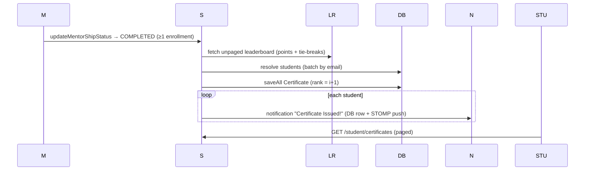

# Certificates — Primary Domain Document

## 1. Overview

Certificates encode the final promise: when a mentor completes a mentorship, every enrolled student receives a certificate ranked by their leaderboard position. **Certificates are database rows only — no PDF is generated for them** despite README/docs claims.

## 2. Current Implementation

### 2.1 Entity & storage
- `entity/certificate/Certificate` — `student`, `mentorship`, `rank` (column `student_rank`), `issuedAt`; **unique (student_id, mentorship_id)** (prevents duplicates). No score field stored (rank implies ordering only).

### 2.2 Issuance flow
`service/certificate/CertificateService#issueCertificates(mentorshipId)` (`@Transactional`):
1. Mentor-ownership check via `SecurityService.isMentorOwnMentorship` (indirect — invoked from the status transition which already checked).
2. Fetch the **entire** leaderboard: `TotalPointsRepository#findLeaderboardByMentorshipId(mentorshipId, Pageable.unpaged())` (heavy JPQL with badge tie-breaks).
3. Resolve students in one batch (`studentRepository.findAllByEmailIn`).
4. `rank = loopIndex + 1` (points DESC; ties broken by `s.id ASC` — arbitrary but deterministic).
5. `saveAll` certificates; **one notification per student** (STOMP + row; loop).

Trigger: `mentorShipServiceI#updateMentorShipStatus` (lines 291–299) — on `ACTIVE → COMPLETED` only; guards make re-issue impossible (terminal state + unique constraint).

### 2.3 Student surface
- `GET /api/v1/student/certificates` (STUDENT, paginated) — `CertificateRepository#findByStudentEmail` projection: student name, mentor name, mentorship title/subtitle, `rank`, `issuedAt`. No download/print artifact exists.

### 2.4 PDF reality (documentation mismatch)

- iText7 is present in `pom.xml` but **used only by `service/admin/BadgePdfGeneratorService`** (admin badge award emails; verified by grep).
- README claims iText7 "styled PDF certificates with cohort rank and issue date" — **not implemented**: the certificates flow writes rows nothing renders. This is a confirmed documentation gap and a candidate stabilization feature (introduced as a recommendation: keep the template files approach used for emails).

## 3. Workflows & Data Flow

Transactional entanglement: issuance + fan-out notifications run inside the completion transaction (see [../mentorship-flow/mentorship-lifecycle.md](../mentorship-flow/mentorship-lifecycle.md)); no email side effects exist for certificates.

## 4. Data Model & Consistency

- Rank depends on leaderboard state **at completion moment** (post-completion badge edits cannot change it — badges still mutable on a COMPLETED mentorship? verified: `BadgeService#updateBadge` has no status check → mentor may edit badges after completion; ledger update would run on a completed mentorship's points but certificates remain frozen — inconsistent edge).
- Ties broken by `students.id` — a deterministic but arbitrary tie-break surfaced in the UI as rank.

## 5. Security

- Student endpoint: role-gated, self-scoped by email — safe.
- Issuance path ownership double-checked (status transition + service check).

## 6. Testing

Zero tests. Recommended:
1. Completion with N students → N rows, ranks 1..N, no duplicates on second completion attempt (terminal guard).
2. Tie-break determinism (doc rank policy).
3. Post-completion badge edit does not alter ranks (document current behavior).

## 7. Known Issues

- **CERT-01 (High):** docs claim PDF certificates; none exist (no rendering path, no templates).
- **CERT-02 (Medium):** rank exposed without score/percentage context.
- **CERT-03 (Low):** unpaged leaderboard fetch (memory scaling for very large cohorts).
- **CERT-04 (Medium):** badge edits allowed post-completion mutate points/leaderboards while certificates freeze — inconsistent state surface.

## 8. Open Questions

- Should certificates include final points, completion rate, or mentor signature lines? (Requires product + design decision before implementing PDF export.)
- Should completion auto-archive the leaderboard (frozen snapshot table) to guarantee consistency?

## 9. Related Documentation

[../mentorship-flow/mentorship-lifecycle.md](../mentorship-flow/mentorship-lifecycle.md) · [../learning-content/my-learning-and-achievements.md](../learning-content/my-learning-and-achievements.md) · [../integrations/MDS.md](../integrations/MDS.md) (iText) · [../ISSUES.md](../ISSUES.md)
