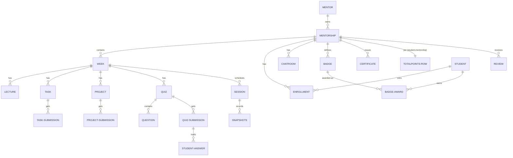

# Entity Relationships — Full Catalog (43 classes)

Verified from `src/main/java/com/example/gradproj/EduNest/entity/**`. Convention: `[audit]` = extends `BaseEntity` (id, createdAt, updatedAt, createdBy, updatedBy). `PK` inheritance noted where JOINED tables apply.

## 1. Users & identity

| Entity | Table | Key fields | Relations |
|---|---|---|---|
| `UserEntity` *(abstract, `[audit]`)* | `users` | email (unique), password (BCrypt), firstName/lastName, phoneNumber, `profileImageUrl`, **`enabled`** (default false), **`deleted`** (soft delete) | `@ManyToOne(LAZY) role → Roles` (required); `socialMediaLinks → SocialMedia` (cascade ALL, orphanRemoval); `rooms → chat/ChatRoom` |
| `Student` `[audit]` | `students` (JOINED, PK `student_id`) | `educationalLevel` (enum), address, jobTitle, bio(500) | `enrollments` → Enrollment (JsonIgnore), `reviews` → MentorShipReviews, `badgeAwards` → BadgeAward, `skills` → StudentSkill |
| `Mentor` `[audit]` | `mentors` (JOINED, PK `mentor_id`) | jobTitle, bio(500), yearsOfExperience | `mentorships` → MentorShip (JsonIgnore) |
| `Admin` *(independent root, `[audit]`)* | `admins` | email, password, firstName/lastName, profilePicture, headline | `role → Roles`; **no enabled/deleted columns** (always login-valid) |
| `Roles` *(no audit)* | `roles` | name (unique) | seeded: ADMIN/MENTOR/STUDENT ([../authentication-security/security-configuration.md](../authentication-security/security-configuration.md)) |
| `SocialMedia` `[audit]` | — | name (enum `Media`), url; owner side of UserEntity.link | – |
| `StudentSkill` *(no audit)* | — | `skill` free-text; student FK | – |

## 2. Mentorship domain

| Entity | Table | Key fields | Relations |
|---|---|---|---|
| `MentorShip` `[audit]` | `mentorship` | title/subtitle/description(2000), category (free text, lowercased), `rating` (denormalized avg), difficultyLevel enum, `status` (DRAFT/ACTIVE/COMPLETED), price, discountPercentage, coverImageUrl, duration | `@ManyToOne(LAZY) mentor → Mentor`; `@OneToMany` cascade ALL: whatWillLearn, tags, enrollments, reviews (`@JsonManagedReference`), weeks, chatRooms, totalPoints, badges, certificates; **no start-date field** (`//ToDo StartDate`) |
| `Enrollment` `[audit]` | `enrollments` | price, `platformProfit` (default 0.0), `joinedAt` (NOT NULL) | student FK (LAZY, NOT NULL), mentorShip FK (NOT NULL); **index (student_id, mentorship_id) NOT unique** |
| `MentorShipReviews` `[audit]` | `mentorship_reviews` | feedBack(≤500), rating (primitive long) | mentorShip (`@JsonBackReference`) + student; **no unique (mentorship, student)** |
| `Week` `[audit]` | `weeks` | title (NOT NULL) | `@ManyToOne mentorship` NOT NULL; `@OneToMany` cascade ALL: tasks, quizzes, projects, liveSessions, lectures; **no order/position column** |
| `Commission` `[audit]` | `commission` | rate double NOT NULL | append-only rate history; "current" = latest by createdAt |
| `Tags` `[audit]` | — | tag NOT NULL (lowercased) | mentorship FK LAZY (nullable!) |
| `WhatWillLearn` `[audit]` | `mentorship_what_will_learn` | content(255) NOT NULL lowercased | mentorship FK NOT NULL |

## 3. Curriculum content

| Entity | Table | Key fields | Relations |
|---|---|---|---|
| `lectures/Lecture` `[audit]` | `lectures` | `lecture_title`, `lecture_url` | `@ManyToOne(LAZY) week` NOT NULL; index `idx_lectures_week_id`; no status/order |
| `tasks/Task` `[audit]` | — | title, description(≤10k), points, **passPoints (never read for logic)**, estimatedMinutes, status (`TaskStatus` DRAFT/PUBLISHED/CLOSED), `dueAt` NOT NULL, attachmentUrl/uploadedAttachmentPath | `@ManyToOne week` NOT NULL (idx `idx_task_week_id`); `@OneToMany submissions` cascade ALL |
| `tasks/TaskSubmission` `[audit]` | — | fileUrl/uploadedFilePath, **rawScore (= max points, mislabeled)**, finalScore, feedBack, status (`SubmissionStatus` SUBMITTED/GRADED used), submittedAt, gradedAt, isLate, **pointsApplied** | task FK + student FK; **unique (task_id, student_id)** |
| `projects/Project` `[audit]` | — | title(≤150), brief(≤10k), goal, descriptionUrl, attachment, `startAt`/`endAt` NOT NULL, points, status (`ProjectStatus`) | week FK NOT NULL; `@OneToMany submissions` |
| `projects/ProjectSubmission` `[audit]` | — | same scoring shape as TaskSubmission | project FK + student FK; **unique (project_id, student_id)** |
| `quiz/Quiz` `[audit]` | — | title(≤100), description(≤500), durationMinutes, status (`QuizStatus`) | week FK; `@OneToMany questions`, `submissions` cascade ALL; **no quiz-level points/deadline** |
| `quiz/Question` `[audit]` | — | text(≤500), **points int**, `correctAnswer` enum (`AnswerChoices` A/B/C/D) — *stored in DB*, optionA..D | quiz FK; `@OneToMany studentAnswers` |
| `quiz/QuizSubmission` `[audit]` | — | score (Double), startDate, endDate | student+quiz FK; **unique (student_id, quiz_id)**; `@OneToMany answers` orphanRemoval |
| `quiz/StudentAnswer` `[audit]` | — | selectedAnswer (String) | submission FK + question FK; **unique (submission_id, question_id)** |

## 4. Gamification

| Entity | Table | Key fields | Relations |
|---|---|---|---|
| `points/TotalPoints` `[audit]` | `total_points` | totalPoints Integer (default 0) | student FK + mentorship FK (both NOT NULL) — **unique `uk_student_mentorship`**; row born with enrollment |
| `badges/Badge` `[audit]` | — | title, category (`BadgeCategory` ×8), description, points int (@Min1/@Max500) | mentorship FK (required); `@OneToMany awards` |
| `badges/BadgeAward` `[audit]` | — | note; awardedBy (Mentor FK) | badge FK + student FK; **unique (badge_id, student_id)** |
| `admin/AdminBadge` `[audit]` | — | 4 fixed types (TOP_MENTOR, ACADEMIC_EXCELLENCE, COMMUNITY_LEADER, INNOVATOR_AWARD), points value = none | – |
| `admin/UserAdminBadge` `[audit]` | — | recognitionNote, awardedAt | user FK + adminBadge FK; **unique (user_id, admin_badge_id)** |

## 5. Live sessions

| Entity | Table | Key fields | Relations |
|---|---|---|---|
| `Session` `[audit]` | `sessions` | title, scheduledAt, actualStartTime, actualEndTime, meetingUrl, `status` (`SessionStatus` SCHEDULED/LIVE/ENDED) | `@ManyToOne week`; `@OneToMany attendances`, `attendanceResults`; idx `idx_sessions_week_id` |
| `SessionAttendance` `[audit]` | — | snapshotTime | session FK + student FK; **no unique pair** (repeated snapshots by design) |
| `SessionAttendanceResult` `[audit]` | — | attended boolean | one final row per (session, student) written at session end |

## 6. Chat (group rooms + private)

| Entity | Table | Key fields | Relations |
|---|---|---|---|
| `chat/ChatRoom` `[audit]` | — | name, cover image, `creator` | mentorship FK (`mentorship.chatRooms` inverse); `@OneToMany members` |
| `chat/ChatRoomMember` *(no audit)* | — | joinedAt (LocalDateTime) | room FK + user FK |
| `chat/ChatMessage` `[audit]` | — | content (≤10k), **sender_id + denormalized senderEmail + senderName** | chatRoom FK; **no read/unread flag** |
| `chat/Conversation` *(no audit, has `@CreationTimestamp createdAt`)* | — | ordered/unordered user pair (user1/user2) | **no unique constraint**; `@OneToMany messages` |
| `chat/Message` *(no audit)* | — | content, sentAt, `seen` boolean (never set true), `updated` boolean (no timestamp) | conversation FK + sender FK |

## 7. Notifications, certificates, auth-support, contact

| Entity | Table | Key fields | Relations |
|---|---|---|---|
| `Notification` `[audit]` | — | title, content(≤700), type enum (11 values) | fan-out target of `UserNotification` |
| `UserNotification` `[audit]` | — | `is_read` (default false) | user FK + notification FK; **unique pair**; idx `idx_notifications_user_id` |
| `AdminNotification` `[audit]` | — | title/content/type | `admin_id` FK (single newest admin via repository query) |
| `certificate/Certificate` `[audit]` | — | `rank` (column `student_rank`), issuedAt | student FK + mentorship FK; **unique (student_id, mentorship_id)** |
| `register/OTP` `[audit]` | — | `otp_code` (plaintext 6 digits), `expires_at`, `otp_type` (VERIFY/RESET/DEFAULT/DELETE/RESTORE/CHANGE_EMAIL), `pendingEmail` | user FK **or** admin FK (two flows); one row per user by service convention |
| `contactus/ContactMessageEntity` `[audit]` | — | sender name/email, message, `status` (enum lives in `enums/message/MessageStatus`: PENDING/UNDER_REVIEW/COMPLETED — package quirk), admin reply fields | – |

## 8. Cardinality map (mermaid)

## 9. Reading guide

- For **field-level security-sensitive details** (enabled/deleted, OTP storage): [../authentication-security/authentication-flow.md](../authentication-security/authentication-flow.md#7-data-model-auth-relevant)
- For **score/points columns semantics** (rawScore, pointsApplied): [../learning-content/tasks-workflow.md](../learning-content/tasks-workflow.md)
- For which constraints are *missing*: [MDS.md §7](MDS.md#7-data-model--integrity--constraints-summary)
