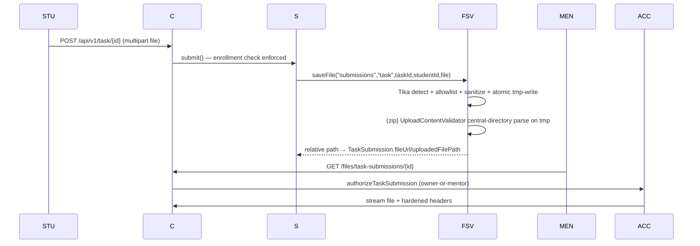

# File Storage & Uploads — Primary Domain Document

## 1. Overview

Two storage services coexist with different rigor levels:

1. **`FileStorageService`** (secure path) — Tika content sniffing, extension allow/deny lists, sanitized naming, atomic writes, traversal guards. Used for submissions/attachments.
2. **`ImageStorageService`** (hardened path, EB-29 [P1-22]) — image saves for avatars/cover images/chatroom images prove the actual bytes via the shared `service/fileSotageService/UploadContentValidator` (magic bytes + structural checks + JDK decode for jpg/png) before anything is written; the stored extension comes from the detected format, not the client filename.

The proposed **upload exposure policy ([P1-21]/EB-28, D-07)** serves only four anonymous-public folders statically. The legacy arbitrary-path endpoint is disabled pending an ownership-aware replacement; private categories use typed, ownership-checked `/files/**` endpoints.

## 2. Current Implementation

### 2.1 `service/fileSotageService/FileStorageService` *(sic — package typo is real)*
- Base dir: `${app.upload.base-dir:uploads}` created at startup (`@PostConstruct`).
- `MAX_FILE_SIZE = 10MB` (mirrors `spring.servlet.multipart.max-*`).
- **Tika**: `detectMimeType` streams the head of the file (lines 211–227); `validateMimeTypeCompatibility` requires detected MIME to `startsWith` one of an allowed set per extension — anti-extension-spoofing (229–254).
- **Allowlist**: pdf, docx, xlsx, pptx (plus `application/x-tika-ooxml`), txt, jpg/jpeg/png/gif, zip (**EB-29 [P1-22]: the weak `application/octet-stream` zip mapping is removed** - only `application/zip` / `application/x-zip-compressed` remain, and a saved `.zip` must additionally pass a structural central-directory parse (`UploadContentValidator#verifyZipIntegrity` on the temp file before it is moved)).
- ZIP entries are read and checked against their declared uncompressed sizes and CRC32 before the temporary file is moved. Validation limits are 10,000 entries, 64 MiB per entry and 256 MiB total uncompressed; archives exceeding these limits are rejected.
- **EB-29 error mapping**: mislabeled uploads (content/extension mismatch) and MIME-blocked files now throw `globalLogicEx` and answer **400 `ERR_BUSINESS_RULE`** through the EB-12 envelope instead of the sanitized catch-all 500.
- **Blocklists**: `BLOCKED_EXTENSIONS` (exe/dll/bat/sh/php/jsp/html/js/jar/py/…), `BLOCKED_MIME_TYPES` (x-msdownload, x-executable, x-sh, x-httpd-php, **text/html**, javascript).
- **Naming**: null-byte + control-char strip, `^[a-zA-Z0-9_.-]+$` sanitization, final `{type}-{id}-{secondaryId}-{uuid}.{ext}`; subfolder validated `^[a-zA-Z0-9_-]+$`.
- **Write**: copy-to-`.tmp` → verify size → move → attempt POSIX `rw-------` (no-op on Windows/unsupported FS).
- **Delete**: traversal-guarded (must remain inside the resolved base dir).

Consumers (verified literals):
| Caller | Subfolder |
|---|---|
| `TaskSubmissionServiceImpl#submit` | `uploads/submissions` (`task-…`) |
| `TaskServiceImpl#create/updateTask` | `uploads/task-attachment` |
| `ProjectSubmissionServiceImpl#submit` | `uploads/submissions` (`project-…`) |
| `ProjectServiceImpl#create/updateProject` | `uploads/project-attachment` |

### 2.2 `service/mentorShip/ImageStorageService` (EB-29 [P1-22] hardened)
- **Validation policy** — every image save (`saveCoverImage`, `saveImage`) routes through `UploadContentValidator.validateImageUpload` before any byte is written:
  - detected format must be one of the surface's allowlist: covers + avatars (`student`, `mentor`, `admin`) `jpg/png/webp`; `chatroom` `jpg/png` only;
  - jpg/png require magic bytes **plus a full JDK `ImageIO` decode** (header-passing garbage, truncated bodies and tampered PNG IHDR CRCs are rejected); WebP validation checks the exact RIFF size, chunk boundaries and a plausible VP8 or VP8L image header. VP8X-only files are rejected. Animated WebP, unknown chunks and large extended canvases are rejected conservatively. The project has no WebP decoder: malformed entropy data can still pass these structural checks and be stored;
  - JPEG marker stream is walked to the SOS segment (header completeness) before decode; exotic encodings the JDK cannot decode (e.g. CMYK JPEGs) are conservatively rejected — browsers and standard encoders emit decodable RGB/progressive JPEGs;
  - a double-extension file (`photo.jpg.exe`) whose bytes are a valid JPEG **is normalized**: the stored extension is the detected one (`...-{uuid}.jpg`), FILE-02/FILE-03/MSH-06's spoofer no longer controls the extension, and the URL contract `/uploads/{folder}/{id}-EduNest-{uuid}.{ext}` is unchanged for legitimate uploads;
  - non-blank declared MIME must match the detected format's canonical set (`image/jpeg*` / `image/png` / `image/webp`); missing or `application/octet-stream` declarations are ignored (content decides);
  - limits: 5 MB (`MAX_IMAGE_BYTES`); rejections throw `globalLogicEx` → 400 `ERR_BUSINESS_RULE` and leave **no file, `.tmp` remnant or metadata row behind**.
- Coverage: covers (`POST /api/v1/mentorship/{id}/change-cover-image`), student/mentor/admin avatars, chatroom `PUT /api/v1/chat-room/{roomId}/image`, plus the four FileStorageService destinations for `submissions`/`task-attachment`/`project-attachment` (10 MB there).
- Image writes and MVC reads use `${app.upload.base-dir:uploads}`. If a deployment previously set a non-default root, existing images remain in the former `uploads/` root and need an explicit migration; URLs remain `/uploads/...`.
- **Replace ordering (EB-29)**: every replace flow now saves the new file first and deletes the OLD one only after the save succeeded (`mentorShipServiceI` cover, `StudentProfileService`, `MentorProfileInfoService`, `AdminProfileAndSettingsService`, `ChatRoomService`, `TaskServiceImpl`, `ProjectServiceImpl`, `TaskSubmissionServiceImpl`, `ProjectSubmissionServiceImpl`); a rejected upload no longer destroys the previous stored file. The full replace-window problem (`FILE-05`-type transactional ordering) remains owned by P3-03.

### 2.3 Serving & access — upload exposure policy ([P1-21]/EB-28)

**Single policy source: `config/file/UploadPolicy`.** Both serving layers are generated from it; folder names are the REAL on-disk names written by `ImageStorageService`/`FileStorageService` (resolves TD-09/G14 without renames).

| Category | Folders | Chain (`ProjectSecurityConfig#prodChain`) | Resource handlers (`config/WebConfig`) |
|---|---|---|---|
| anonymous-public | `mentorship-cover-images`, `student`, `mentor`, `chatroom` | `/uploads/{folder}/**` → permitAll (explicit, from `UploadPolicy.PUBLIC_UPLOAD_PATTERNS`) | one handler per folder → `file:{app.upload.base-dir}/{folder}/` |
| private (ownership-checked only) | `submissions`, `task-attachment`, `project-attachment` | `/uploads/**` → **denyAll** (first-match: public patterns win first) | **no handler** → never served directly |
| admin | `admin` | `/uploads/**` denyAll (non-public default) | **no handler** |
| unknown / future | anything else | `/uploads/**` denyAll (fail-closed) | **no handler** |

Private/unknown paths are never reachable via `/uploads/**` — **not even for authenticated users** (denyAll, not `anyRequest().authenticated()`) — and exist only through the typed `/files/**` routes below. If a folder is added on disk it stays denied until `UploadPolicy` is deliberately extended (fail-closed); under Supabase (D-25/[ADD-03], EB-83) the same sets map onto bucket policies.

Also removed as part of the policy: the prod `file:uploads/` entry in `spring.web.resources.static-locations` (it mapped the uploads tree onto the default `/**` resource handler — an unprefixed leak, e.g. `GET /submissions/…` for any authenticated user); public serving is now *only* via the `WebConfig` allowlist. The dev chain (`EDUNEST_UNSAFE_DEV=true`) remains deliberately permissive and is not a deployable configuration.

- **`/files/**`** (`controller/file/FileController`) — typed endpoints route through `service/fileSotageService/FileAccessService` with ownership verification:
  - `GET /files/task-submissions/{id}` / `/files/project-submissions/{id}` — owner student or the mentor of the mentorship mold.
  - `GET /files/tasks/{id}/attachment`, `/files/projects/{id}/attachment` — mentor or enrolled student.
  - **`GET /files?filePath=…&download=`** returns 403 from the handler for authenticated requests with the required parameter: it cannot associate arbitrary paths with owners. Anonymous requests are rejected by the production chain. This is a compatibility break; coordinate migration to typed endpoints and EB-27.
- Regression pins: `security/probes/UploadExposurePolicyProbeTest` covers anonymous/authenticated private denials, public allowlist and returned bytes, independent MVC checks, admin/unknown fail-closed, traversal/encoded variants, configured image root, and task-submission typed-route authorization; `UploadsServingProbeTest` pins the G14 explicit rule; **EB-29 [P1-22]: `security/probes/UploadValidationHardeningProbeTest` pins the hardened upload matrix end-to-end** — real jpg/png/webp accepted per surface (byte-identical serve-back), malformed/spoofed/double-extension/truncated/tampered-CRC images and content-vs-extension-zip mismatches rejected on 400 `ERR_BUSINESS_RULE` with no file/`.tmp`/metadata remnants, stored-extension normalization, per-surface allowlists, and zip integrity including genuine-zip-named-`.pdf` and local-header-only archives.
- Response headers via `util/FileResponseBuilder`: `Cache-Control: no-store`, `X-Content-Type-Options: nosniff`, `Content-Security-Policy: default-src 'none'`, inline vs attachment disposition, MIME by `Files.probeContentType` (octet-stream fallback).

## 3. Data Flow (submission example)

## 4. Known Issues (IDs in ../ISSUES.md)

- **FILE-01 (Critical):** proposed EB-28 changes restrict static serving and disable the generic arbitrary-path download; verification and review remain pending. EB-27 remains relevant for any ownership-aware replacement.
- **FILE-02 (High) — hardened by EB-29 [P1-22]:** image surfaces now detect by content (magic bytes + structural checks + JDK decode) and ignore the client-controlled Content-Type except as a cross-check; regression suite `UploadValidationHardeningProbeTest` (covers/avatars/chatroom/zip/submission spoofing).
- **FILE-03 (Medium) — hardened by EB-29 [P1-22]:** stored extension is derived from the detected format; the client filename no longer reaches the path (double-extension spoofing normalizes to the real type).
- **FILE-04 (Medium) — hardened by EB-29 [P1-22]:** weak `application/octet-stream` zip mapping removed and a stored `.zip` must have a parseable central directory (local-header-only/garbage payloads rejected before the target file is created).
- **FILE-05 (Medium):** rejected/failed uploads no longer destroy the previous stored file (EB-29 flip to save-before-delete in all replace flows); the deeper transactional replace window remains owned by P3-03.
- **FILE-06 (Medium):** repo ships real uploaded user files under `uploads/` (data-in-VCS hygiene issue).
- **FILE-07 (Low):** Container lacks a volume → uploads lost on redeploy (see deployment).

## 5. Open Questions

- D-07 policy is implemented in the EB-28 working tree and pending review: static public serving for four folders; private content uses typed endpoints. FE must coordinate submission, attachment, legacy download and admin-image migrations.
- EB-28 temporarily disables the legacy generic endpoint as a security dependency; this breaks public-category callers and departs from D-06's guard-first default. Eng Lead and FE liaison approval is required; EB-27 remains open for a compatible ownership-aware solution.
- Is blob-store (S3/GCS) planned? — **decided (D-25/[ADD-03], EB-83): Supabase Storage**; until it lands the local-disk exposure policy above is the transitional contract (`UploadPolicy` sets map onto bucket policies).

## 6. Related Documentation

[../learning-content/MDS.md](../learning-content/MDS.md) (consumers) · [../api/endpoints.md](../api/endpoints.md) (`/files/**` surface) · [../deployment/MDS.md](../deployment/MDS.md) (volumes) · [../ISSUES.md](../ISSUES.md) · legacy: [../database/DATABASE_OPTIMIZATION.md](../database/DATABASE_OPTIMIZATION.md) (referenced indexes behind `FileAccessService`)
