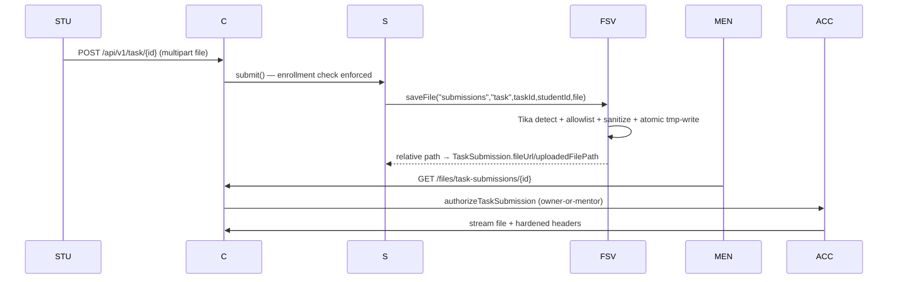

# File Storage & Uploads — Primary Domain Document

## 1. Overview

Two storage services coexist with different rigor levels:

1. **`FileStorageService`** (secure path) — Tika content sniffing, extension allow/deny lists, sanitized naming, atomic writes, traversal guards. Used for submissions/attachments.
2. **`ImageStorageService`** (lenient path) — content-type-header-trusting image saves for avatars/cover images/chatroom images.

The proposed **upload exposure policy ([P1-21]/EB-28, D-07)** serves only four anonymous-public folders statically. The legacy arbitrary-path endpoint is disabled pending an ownership-aware replacement; private categories use typed, ownership-checked `/files/**` endpoints.

## 2. Current Implementation

### 2.1 `service/fileSotageService/FileStorageService` *(sic — package typo is real)*
- Base dir: `${app.upload.base-dir:uploads}` created at startup (`@PostConstruct`).
- `MAX_FILE_SIZE = 10MB` (mirrors `spring.servlet.multipart.max-*`).
- **Tika**: `detectMimeType` streams the head of the file (lines 211–227); `validateMimeTypeCompatibility` requires detected MIME to `startsWith` one of an allowed set per extension — anti-extension-spoofing (229–254).
- **Allowlist**: pdf, docx, xlsx, pptx (plus `application/x-tika-ooxml`), txt, jpg/jpeg/png/gif, **zip (mapping allows the generic `application/octet-stream`)**.
- **Blocklists**: `BLOCKED_EXTENSIONS` (exe/dll/bat/sh/php/jsp/html/js/jar/py/…), `BLOCKED_MIME_TYPES` (x-msdownload, x-executable, x-sh, x-httpd-php, **text/html**, javascript).
- **Naming**: null-byte + control-char strip, `^[a-zA-Z0-9_.-]+$` sanitization, final `{type}-{id}-{secondaryId}-{uuid}.{ext}`; subfolder validated `^[a-zA-Z0-9_-]+$`.
- **Write**: copy-to-`.tmp` → verify size → move → attempt POSIX `rw-------` (no-op on Windows/unsupported FS).
- **Delete**: traversal-guarded (must remain inside the resolved base dir).

Consumers (verified literals):
| Caller | Subfolder |
|---|---|
| `TaskSubmissionServiceImpl#submit` | `uploads/submissions` (`task-…`) |
| `TaskServiceImpl#create/updateTask` | `uploads/task-attachment` |
| `ProjectSubmissionServiceImpl#submit` | `uploads/submissions` (`project-…`) |
| `ProjectServiceImpl#create/updateProject` | `uploads/project-attachment` |

### 2.2 `service/mentorShip/ImageStorageService`
- `saveCoverImage` (mentorship covers) → `uploads/mentorship-cover-images/{id}-EduNest-{uuid}{ext}`; validates only that the original filename contains a dot. Caller (`uploadCoverImage`) checks `MultipartFile.getContentType().startsWith("image/")` — **client-controlled header**; size ≤5MB; **no Tika/magic bytes, no extension whitelist, extension taken raw from filename** (traversal-suspect sub-path; NOTE flagged).
- `saveImage/deleteImage` — same lenient pattern for `student`, `mentor`, `admin`, `chatroom` folders (`deleteImage` wraps IOException; cover deletion logs it). Image writes, deletes and MVC reads use `${app.upload.base-dir:uploads}`. If a deployment previously set a non-default root, existing images remain in the former `uploads/` root and need an explicit migration; URLs remain `/uploads/...`.
- Old cover deleted **before** the new file is committed (failure window → broken `coverImageUrl`).

### 2.3 Serving & access — upload exposure policy ([P1-21]/EB-28)

**Single policy source: `config/file/UploadPolicy`.** Both serving layers are generated from it; folder names are the REAL on-disk names written by `ImageStorageService`/`FileStorageService` (resolves TD-09/G14 without renames).

| Category | Folders | Chain (`ProjectSecurityConfig#prodChain`) | Resource handlers (`config/WebConfig`) |
|---|---|---|---|
| anonymous-public | `mentorship-cover-images`, `student`, `mentor`, `chatroom` | `/uploads/{folder}/**` → permitAll (explicit, from `UploadPolicy.PUBLIC_UPLOAD_PATTERNS`) | one handler per folder → `file:{app.upload.base-dir}/{folder}/` |
| private (ownership-checked only) | `submissions`, `task-attachment`, `project-attachment` | `/uploads/**` → **denyAll** (first-match: public patterns win first) | **no handler** → never served directly |
| admin | `admin` | `/uploads/**` denyAll (non-public default) | **no handler** |
| unknown / future | anything else | `/uploads/**` denyAll (fail-closed) | **no handler** |

Private/unknown paths are never reachable via `/uploads/**` — **not even for authenticated users** (denyAll, not `anyRequest().authenticated()`) — and exist only through the typed `/files/**` routes below. If a folder is added on disk it stays denied until `UploadPolicy` is deliberately extended (fail-closed); under Supabase (D-25/[ADD-03], EB-83) the same sets map onto bucket policies.

Also removed as part of the policy: the prod `file:uploads/` entry in `spring.web.resources.static-locations` (it mapped the uploads tree onto the default `/**` resource handler — an unprefixed leak, e.g. `GET /submissions/…` for any authenticated user); public serving is now *only* via the `WebConfig` allowlist. The dev chain (`EDUNEST_UNSAFE_DEV=true`) remains deliberately permissive and is not a deployable configuration.

- **`/files/**`** (`controller/file/FileController`) — typed endpoints route through `service/fileSotageService/FileAccessService` with ownership verification:
  - `GET /files/task-submissions/{id}` / `/files/project-submissions/{id}` — owner student or the mentor of the mentorship mold.
  - `GET /files/tasks/{id}/attachment`, `/files/projects/{id}/attachment` — mentor or enrolled student.
  - **`GET /files?filePath=…&download=`** returns 403 from the handler for authenticated requests with the required parameter: it cannot associate arbitrary paths with owners. Anonymous requests are rejected by the production chain. This is a compatibility break; coordinate migration to typed endpoints and EB-27.
- Regression pins: `security/probes/UploadExposurePolicyProbeTest` covers anonymous/authenticated private denials, public allowlist and returned bytes, independent MVC checks, admin/unknown fail-closed, traversal/encoded variants, configured image root, and task-submission typed-route authorization; `UploadsServingProbeTest` pins the G14 explicit rule.
- Response headers via `util/FileResponseBuilder`: `Cache-Control: no-store`, `X-Content-Type-Options: nosniff`, `Content-Security-Policy: default-src 'none'`, inline vs attachment disposition, MIME by `Files.probeContentType` (octet-stream fallback).

## 3. Data Flow (submission example)

## 4. Known Issues (IDs in ../ISSUES.md)

- **FILE-01 (Critical):** proposed EB-28 changes restrict static serving and disable the generic arbitrary-path download; verification and review remain pending. EB-27 remains relevant for any ownership-aware replacement.
- **FILE-02 (High):** `ImageStorageService` trusts client Content-Type; no magic-byte checks (covers/avatars/chatroom).
- **FILE-03 (Medium):** filename-extension path construction in `saveCoverImage` (un-sanitized extension substring — traversal-suspect).
- **FILE-04 (Medium):** zip allowlist aligns with `application/octet-stream` (weakened spoofing defense).
- **FILE-05 (Medium):** old-file-deleted-before-new-committed sequence (broken URLs on failure).
- **FILE-06 (Medium):** repo ships real uploaded user files under `uploads/` (data-in-VCS hygiene issue).
- **FILE-07 (Low):** Container lacks a volume → uploads lost on redeploy (see deployment).

## 5. Open Questions

- D-07 policy is implemented in the EB-28 working tree and pending review: static public serving for four folders; private content uses typed endpoints. FE must coordinate submission, attachment, legacy download and admin-image migrations.
- EB-28 temporarily disables the legacy generic endpoint as a security dependency; this breaks public-category callers and departs from D-06's guard-first default. Eng Lead and FE liaison approval is required; EB-27 remains open for a compatible ownership-aware solution.
- Is blob-store (S3/GCS) planned? — **decided (D-25/[ADD-03], EB-83): Supabase Storage**; until it lands the local-disk exposure policy above is the transitional contract (`UploadPolicy` sets map onto bucket policies).

## 6. Related Documentation

[../learning-content/MDS.md](../learning-content/MDS.md) (consumers) · [../api/endpoints.md](../api/endpoints.md) (`/files/**` surface) · [../deployment/MDS.md](../deployment/MDS.md) (volumes) · [../ISSUES.md](../ISSUES.md) · legacy: [../database/DATABASE_OPTIMIZATION.md](../database/DATABASE_OPTIMIZATION.md) (referenced indexes behind `FileAccessService`)
