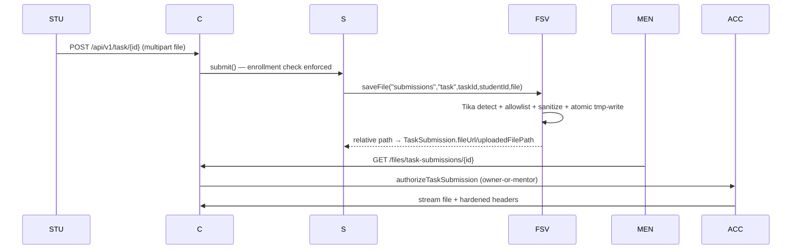

# File Storage & Uploads — Primary Domain Document

## 1. Overview

Two storage services coexist with different rigor levels:

1. **`FileStorageService`** (secure path) — Tika content sniffing, extension allow/deny lists, sanitized naming, atomic writes, traversal guards. Used for submissions/attachments.
2. **`ImageStorageService`** (lenient path) — content-type-header-trusting image saves for avatars/cover images/chatroom images.

Public access via static serving of the entire `uploads/` tree (both profiles) plus typed authenticated download endpoints — with one generic endpoint that bypasses ownership.

## 2. Current Implementation

### 2.1 `service/fileSotageService/FileStorageService` *(sic — package typo is real)*
- Base dir: `${app.upload.base-dir:uploads}` created at startup (`@PostConstruct`).
- `MAX_FILE_SIZE = 10MB` (mirrors `spring.servlet.multipart.max-*`).
- **Tika**: `detectMimeType` streams the head of the file (lines 211–227); `validateMimeTypeCompatibility` requires detected MIME to `startsWith` one of an allowed set per extension — anti-extension-spoofing (229–254).
- **Allowlist**: pdf, docx, xlsx, pptx (plus `application/x-tika-ooxml`), txt, jpg/jpeg/png/gif, **zip (mapping allows the generic `application/octet-stream`)**.
- **Blocklists**: `BLOCKED_EXTENSIONS` (exe/dll/bat/sh/php/jsp/html/js/jar/py/…), `BLOCKED_MIME_TYPES` (x-msdownload, x-executable, x-sh, x-httpd-php, **text/html**, javascript).
- **Naming**: null-byte + control-char strip, `^[a-zA-Z0-9_.-]+$` sanitization, final `{type}-{id}-{secondaryId}-{uuid}.{ext}`; subfolder validated `^[a-zA-Z0-9_-]+$`.
- **Write**: copy-to-`.tmp` → verify size → move → attempt POSIX `rw-------` (no-op on Windows/unsupported FS).
- **Delete**: traversal-guarded (must remain inside the resolved base dir).

Consumers (verified literals):
| Caller | Subfolder |
|---|---|
| `TaskSubmissionServiceImpl#submit` | `uploads/submissions` (`task-…`) |
| `TaskServiceImpl#create/updateTask` | `uploads/task-attachment` |
| `ProjectSubmissionServiceImpl#submit` | `uploads/submissions` (`project-…`) |
| `ProjectServiceImpl#create/updateProject` | `uploads/project-attachment` |

### 2.2 `service/mentorShip/ImageStorageService`
- `saveCoverImage` (mentorship covers) → `uploads/mentorship-cover-images/{id}-EduNest-{uuid}{ext}`; validates only that the original filename contains a dot. Caller (`uploadCoverImage`) checks `MultipartFile.getContentType().startsWith("image/")` — **client-controlled header**; size ≤5MB; **no Tika/magic bytes, no extension whitelist, extension taken raw from filename** (traversal-suspect sub-path; NOTE flagged).
- `saveImage/deleteImage` — same lenient pattern for `student`, `mentor`, `admin`, `chatroom` folders (delete swallows IOException).
- Old cover deleted **before** the new file is committed (failure window → broken `coverImageUrl`).

### 2.3 Serving & access
- `config/WebConfig`: `registry.addResourceHandler("/uploads/**").addResourceLocations("file:uploads/")` (all per-folder variants commented out).
- `application-prod.properties` additionally adds `file:uploads/` to `spring.web.resources.static-locations`.
- Security: **`/uploads/**` is permitAll in BOTH profiles** — including `uploads/submissions/*` student work; the code carries `//ToDo public uploads until front make the security on it` (`ProjectSecurityProdconfig` L88). Actual folder names used by code (`student`, `mentor`, `submissions`, `chatroom`) don't all match the individually-listed rule names (`student-profile`, `mentor-profile`, `profile-images`) — only the catch-all covers reality.
- **`/files/**`** (`controller/file/FileController`) — typed endpoints route through `service/fileSotageService/FileAccessService` with ownership verification:
  - `GET /files/task-submissions/{id}` / `/files/project-submissions/{id}` — owner student or the mentor of the mentorship mold.
  - `GET /files/tasks/{id}/attachment`, `/files/projects/{id}/attachment` — mentor or enrolled student.
  - **`GET /files?filePath=…&download=` (`serveFile`, L114–136) performs no ownership check** — any authenticated user (prod) can download any uploads path by name; traversal itself is properly blocked (null-byte, normalization, `startsWith` base, directory refusal).
- Response headers via `util/FileResponseBuilder`: `Cache-Control: no-store`, `X-Content-Type-Options: nosniff`, `Content-Security-Policy: default-src 'none'`, inline vs attachment disposition, MIME by `Files.probeContentType` (octet-stream fallback).

## 3. Data Flow (submission example)

## 4. Known Issues (IDs in ../ISSUES.md)

- **FILE-01 (Critical):** `/uploads/**` public incl. submissions + generic `/files?filePath=` no-ownership download.
- **FILE-02 (High):** `ImageStorageService` trusts client Content-Type; no magic-byte checks (covers/avatars/chatroom).
- **FILE-03 (Medium):** filename-extension path construction in `saveCoverImage` (un-sanitized extension substring — traversal-suspect).
- **FILE-04 (Medium):** zip allowlist aligns with `application/octet-stream` (weakened spoofing defense).
- **FILE-05 (Medium):** old-file-deleted-before-new-committed sequence (broken URLs on failure).
- **FILE-06 (Medium):** repo ships real uploaded user files under `uploads/` (data-in-VCS hygiene issue).
- **FILE-07 (Low):** Container lacks a volume → uploads lost on redeploy (see deployment).

## 5. Open Questions

- Intended policy for submissions/attachments once the frontend adds access control: keep static public serving for *public* folders only and route artifacts through `/files/**` typed endpoints? (Recommend; current config makes everything public meanwhile.)
- Is blob-store (S3/GCS) planned? Current design couples storage to local disk + container FS.

## 6. Related Documentation

[../learning-content/MDS.md](../learning-content/MDS.md) (consumers) · [../api/endpoints.md](../api/endpoints.md) (`/files/**` surface) · [../deployment/MDS.md](../deployment/MDS.md) (volumes) · [../ISSUES.md](../ISSUES.md) · legacy: [../database/DATABASE_OPTIMIZATION.md](../database/DATABASE_OPTIMIZATION.md) (referenced indexes behind `FileAccessService`)
