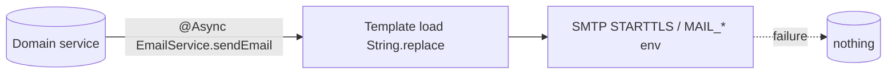

# Integrations & External Dependencies — Primary Domain Document

## 1. Overview

External systems EduNest actually talks to, and libraries it embeds for specialized processing. Each entry records: what the integration *is* in code (Minimal/standard), what its docs claim, config source, and failure behavior.

**Scope:** `service/livesession/JitsiService`, `service/register/EmailService` + `templates/emails/*`, `service/fileSotageService/FileStorageService` (Tika), `service/admin/BadgePdfGeneratorService` (iText), `config/swagger/OpenApiConfig`, `service/jwt/JwtService` (jjwt).

Supporting detail: [external-services.md](external-services.md) (per-template/per-config tables).

## 2. Integration Inventory (verified)

| Integration | Code reality | Docs claim | Key gap |
|---|---|---|---|
| **Jitsi Meet** | `JitsiService` = 15 lines: builds `https://meet.jit.si/EduNest_Session_{id}_{UUID}`. No JWT/auth/domain config anywhere | README/books claim JWT-protected rooms | Public rooms; URL-distribution-only security — [../live-sessions/MDS.md](../live-sessions/MDS.md) |
| **SMTP mail** | `EmailService.sendEmail` (`@Async`), Thymeleaf-style manual `String.replace` placeholders; `sendHtmlEmail`; template loader reads `templates/emails/` | standard | No error surfacing strategy: async task exceptions execute in a `try/catch` inside the method (message printed, no retry/queue); a failing SMTP never affects the caller |
| **Apache Tika** | Used **only** in `FileStorageService` (submission/attachment MIME detection) | README claims Tika validates uploads generally | Covers submissions only — covers/profile images trust the client's `Content-Type` header ([../file-storage/MDS.md](../file-storage/MDS.md)) |
| **iText7** | Used **only** by `BadgePdfGeneratorService` (admin badge award email attachment) | README/books claim iText renders student **certificates** | No certificate PDF path exists — `templates/emails/certificate-template.html` is **unreferenced** by any code (grep-verified) — [../certificates/MDS.md](../certificates/MDS.md) |
| **jjwt** | JWT sign/verify HS256 | standard | hardcoded fallback secret ([../authentication-security/MDS.md](../authentication-security/MDS.md)) |
| **springdoc-openapi** | Swagger UI at `/swagger-ui/**`, generator infos in `OpenApiConfig` (title/description/contact) | intended | Public in prod `permitAll` |
| **MySQL** | JDBC + Spring Data; connection env-driven | standard | `ddl-auto=update` as the schema tool ([../database/MDS.md](../database/MDS.md)) |
| **Dead dep: JavaFX** | `org.openjfx:javafx-base:20` in `pom.xml` — zero imports found | – | Candidate removal |

## 3. Email flow

- Templates are plain HTML with `{{PLACEHOLDER}}` tokens replaced manually (no Thymeleaf engine in the mail path).
- Async = one-way; no template-engine validation, no attachment handling except the admin badge PDF.
- Compose the full per-template usage map: [external-services.md §2](external-services.md#2-email-template-usage-map).

## 4. Failure behavior

- SMTP is the only truly external runtime dependency besides MySQL (URL availability aside). Email failures cannot poison transactions because sending is `@Async` — but that also means *no* delivery feedback exists anywhere (no bounce log, no outbox table).
- `AdminBadgeService` defers its email to `TransactionSynchronization.afterCommit` — the only place that decouples mail from transactional state ([../gamification/MDS.md](../gamification/MDS.md)).
- Jitsi has no health/connection concerns (it's just a URL string).

## 5. Known Issues

- **INT-01 (Low):** unused JavaFX dependency in `pom.xml`.
- **INT-02 (Medium):** no email-delivery observability: async task exceptions are swallowed into logs; no retry, no dead-letter, no outbox pattern; `sendHtmlEmail` catches and prints.
- **INT-03 (Low):** dead email template `certificate-template.html` (unused), consistent with the unimplemented certificate PDF feature.
- Cross-references: LS-01 (Jitsi auth), CERT-01 (PDF certificates), FILE-02 (Tika coverage), SEL-01 (JWT secret).

## 6. Open Questions

- Should admin "platform mail" (`POST /send`, public endpoint) remain open? It lets anyone send arbitrary email through the platform mailbox to arbitrary recipients (contact-us style `{{name}}`/`{{message}}` merge) — treat as test leftover — tracked in [../ISSUES.md](../ISSUES.md) §9 as **MAIL-01**.
- Is a self-hosted Jitsi with server-signed JWT desired at all? If not, the books should be updated to reflect reality.

## 7. Related Documentation

[external-services.md](external-services.md) · [../live-sessions/MDS.md](../live-sessions/MDS.md) · [../certificates/MDS.md](../certificates/MDS.md) · [../file-storage/MDS.md](../file-storage/MDS.md) · [../deployment/MDS.md](../deployment/MDS.md) · [../ISSUES.md](../ISSUES.md)
