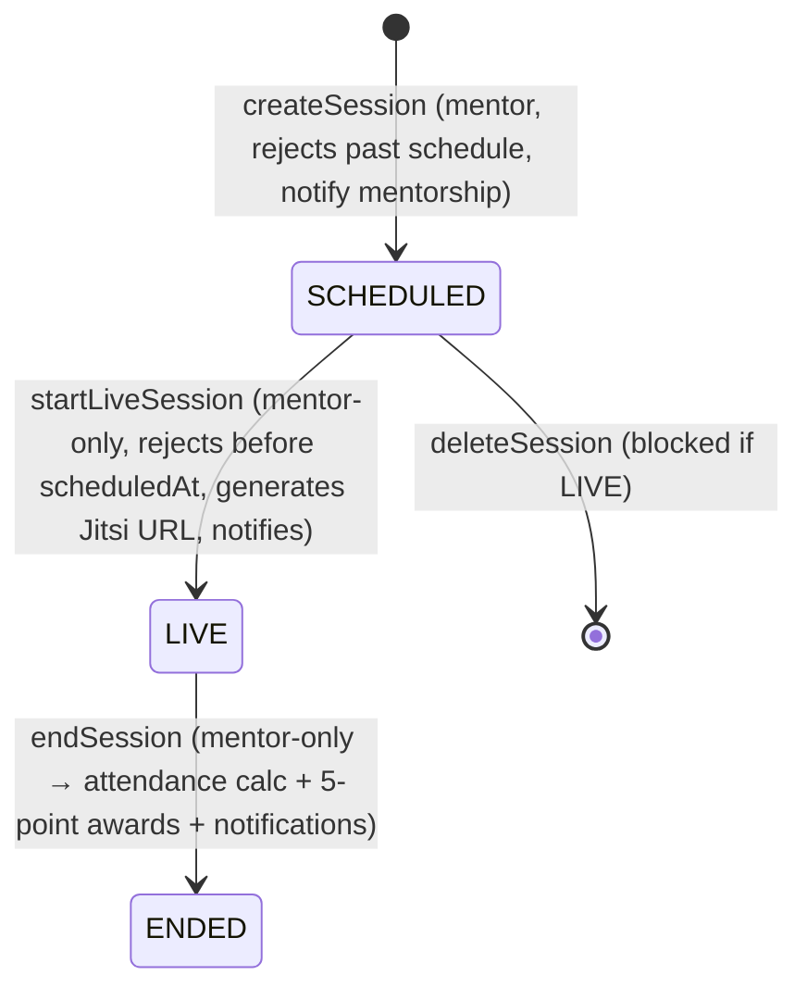

# Live Sessions & Attendance — Primary Domain Document

## 1. Overview

Mentors schedule sessions inside curriculum weeks; each session is a **public Jitsi Meet room** whose URL becomes available only through this backend; attendance is mentor-driven via manual snapshot posting; ending a session compiles attendance percentages, awards a flat 5 points to attendees, and notifies everyone.

**Business value:** real-time teaching moments, attendance-based engagement points feeding the leaderboard.

## 2. Current Implementation

### 2.1 Entities & enums
- `entity/livesession/Session` (table `sessions`, index `idx_sessions_week_id`): `title`, `scheduledAt`, `actualStartTime`, `actualEndTime`, `meetingUrl`, `status` (`enums/livesession/SessionStatus`: `SCHEDULED, LIVE, ENDED`), `week` FK; `@OneToMany` `attendances`, `attendanceResults` (cascade ALL).
- `entity/livesession/SessionAttendance` (session_id, student_id, `snapshotTime`) — raw snapshots; **no unique constraint** on (session, student) — repeats by design.
- `entity/livesession/SessionAttendanceResult` (`attended` boolean) — one final row per (session, student) written at end.
- No status enum on lectures/others; sessions are the only content with a runtime state machine (manual).

### 2.2 Jitsi integration — reality check

`service/livesession/JitsiService` is **15 lines**: `createRoomLink(sessionId)` → `https://meet.jit.si/EduNest_Session_{id}_{UUID}`.

- **No JWT, no token, no secret, no configured domain** (no Jitsi properties anywhere in `application*.properties`; no jitsi JWT library usage).
- README/books claim JWT-protected Jitsi rooms — **this does not exist in code** (DOC issue).
- Security therefore = "the URL is distributed only to enrolled students via `joinSession`"; anyone who obtains the URL has a public room (meet.jit.si is intentional demo-grade).

### 2.3 Lifecycle (`service/livesession/LiveSessionServiceImp`)

- `joinSession` — mentor-or-enrolled-student audience check (`AuthorizationRepository.isMentorOwnLiveSession` / `isStudentEnrolledByLiveSessionId`); rejects non-LIVE/null URL. **No join-time attendance row** — attendance is snapshot-driven.
- `updateSession` — requires date+time **together**; notifies students.
- **No `@Scheduled` jobs exist for sessions** (the only scheduler in the app is OTP cleanup) — status changes are fully manual; a forgotten ENDED state is possible forever.

### 2.4 Attendance math (`getSessionAttendance` + `calculateAttendancePoints`, lines ~394–481)

- `sessionDuration = minutes(actualStart, actualEnd)`
- `totalSnapshots = max(1, duration/5)` — assumes a snapshot **every 5 minutes**
- `percentage = snapshotsTaken * 100.0 / totalSnapshots`
- `Present ⇔ percentage ≥ 75` (arbitrary constant)
- `endSession` then: writes `SessionAttendanceResult` for **every** enrolled student (default Absent), **+5 points** for each Present via `applyDelta`, one notification per student (loop; per-student 2 extra queries + a STOMP push — N+1 pattern).
- **Percentages can exceed 100** (snapshots not rate-limited to the 5-minute grid), and a mentor who never posts snapshots marks everyone Absent (0 points) regardless of actual presence.

### 2.5 Snapshot ingestion (`recordSnapshot`)

Mentor-only; validates each provided student id against enrollment, then inserts one `SessionAttendance` row per id **in a loop of `save()`** (no batch). No dedupe window — the math is snapshot-count-based, so duplicates inflate.

## 3. Interfaces & Contracts (summary)

Controller `/api/v1/liveSession/**` — endpoints: create/update/list/delete (MENTOR), start/join/end/snapshots/attendance (MENTOR), student attendance + upcoming (STUDENT), `getSession` for both roles with audience checks. DTO sets: `CreateSessionDto`/`UpdateSessionDto` (`@NotBlank title`, date/time validation), `SessionResponseDto`, `AttendanceResponse{attendancePercentage, status}`, upcoming-session variants for student/mentor, dashboard variant. Full paths: [../api/endpoints.md](../api/endpoints.md).

## 4. Security & Validation

- Audience checks verified: mentor-own-week/session, student enrolled (per-session). `getSession` relies on service membership check rather than annotation (documented).
- Meeting URL exposure is inherent to the design (no tokened Jitsi access) — documented as accepted risk/open question.

## 5. Error Handling & Edge Cases

- Starting before `scheduledAt` rejected; starting a LIVE/ENDED rejected; joining a SCHEDULED/ENDED session rejected.
- End → ENDED is idempotent-guarded (status check); a second end call rejected.
- No cleanup job for forever-SCHEDULED stale sessions.

## 6. Testing

Zero tests. Recommended: lifecycle transitions matrix; attendance math (snapshot grid vs manual; overflow >100%); enrollment audience; point awarding exactly once per end (status guard).

## 7. Known Issues (IDs in ../ISSUES.md)

- **LS-01 (High):** docs-vs-code mismatch — Jitsi JWT protection does not exist (public rooms).
- **LS-02 (Medium):** attendance denominator assumptions; >100% percentages; snapshotless end marks everyone Absent (award semantics).
- **LS-03 (Medium):** no scheduled auto-lifecycle; sessions expire/leak stale statuses.
- **LS-04 (Low):** per-row snapshot saves (no batching); per-student notification loop (N+1 + pushstorm).
- **LS-05 (Low):** missing `@Transactional` on `startLiveSession`/`recordSnapshot` (inconsistent transactional style).

## 8. Open Questions

- Is `meet.jit.si` acceptable for production, or is a self-hosted Jitsi (with app-issued JWT) planned? (Decide before stabilization: integration doc + secret handling.)
- Was automated attendance (join-time markers) intended? Current design is mentor-driven only.
- Confirm the 5-point award & 75% threshold as product constants (hardcoded).

## 9. Related Documentation

[../integrations/MDS.md](../integrations/MDS.md) (external-settlement detail) · [../learning-content/my-learning-and-achievements.md](../learning-content/my-learning-and-achievements.md) (points) · [../ISSUES.md](../ISSUES.md)
