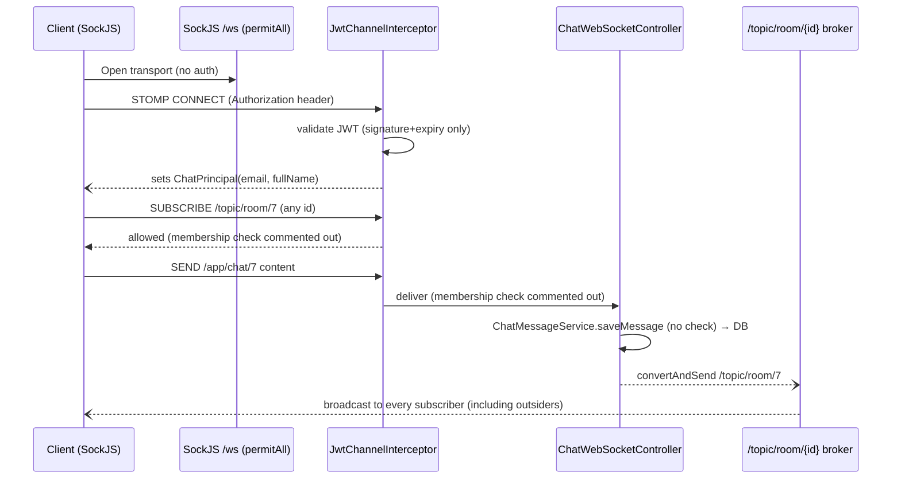

# WebSocket Connection Lifecycle & Authorization

Verified walkthrough of `config/webSocket/` with exact line citations. The key deliverable of this document: **which authorization checks exist vs are disabled**, and the resulting exposure.

## 1. Endpoints & transports

- `WebSocketConfig#registerStompEndpoints` (lines 34–38): **`/ws`**, `setAllowedOriginPatterns("*")`, `.withSockJS()` (XHR-family fallback transports included).
- HTTP path `/ws/**` is `permitAll` in both security profiles — **no HTTP-side auth** before the STOMP session starts.

## 2. Handshake phase — dead interceptor

`JwtHandshakeInterceptor` (`@Component`) checks a JWT from the **query parameter** `Authorization` (`?Authorization=<jwt>`, lines 36–39), validates it, and stores `email`/`fullName` in session attributes.

**It is never registered**: `WebSocketConfig` adds no `addInterceptors(...)` on the endpoint; grep finds only self-references. ⇒ the handshake is anonymous; tokens never appear in URLs today. (If re-enabled to support SockJS transports, the query-token design leaks tokens into access logs — see open questions in [MDS.md](MDS.md).)

## 3. STOMP frame phases (`JwtChannelInterceptor.preSend`)

| Command | What runs today | State |
|---|---|---|
| **CONNECT** | Requires native header `Authorization` (raw JWT, no `Bearer ` prefix). `jwtService.isTokenValid` else `InvalidJwtToken`. On success: `accessor.setUser(new ChatPrincipal(email, fullName))` (lines 52–70) | ✅ active |
| **SUBSCRIBE** | Guards: `user == null` → reject; null destination. **Room-membership check fully commented out (lines 87–105).** | ⛔ authorization absent |
| **SEND** | Guards: `user == null`; for `/app/chat/` destinations extracts `{roomId}` and **the membership check is commented out (lines 130–140)** | ⛔ authorization absent |
| **DISCONNECT** | `System.out.println("Disconnected: " + email)` only; session-map removal commented (lines 146–155) | debug only |

Notes:
- The single-session `connectedUsers` map (one session per account) is commented out — multiple concurrent sessions per account are allowed.
- `isTokenValid` (`service/jwt/JwtService`) checks signature+expiry only — **no enabled/deleted re-check at CONNECT**, unlike the HTTP validator filter. A token issued before deactivation stays usable for the full 7 days on the WS surface.
- `extractRoomId` parses the trailing path segment (`lastIndexOf('/')+1`).

## 4. Dead-code trap (cannot be "just re-enabled")

The commented blocks call `chatRoomRepository.isUserInRoom(email, roomId)` — **no such method exists** on `repository/chat/ChatRoomRepository` (verified by full read). The interceptor injects the repository (line 21) solely for this. Re-enabling the guard as written will not compile; the team must first add a membership query (or reuse `AuthorizationRepository#isUserMemberOfChatRoom`, which checks mentorship-based membership rather than explicit room join).

## 5. What any authenticated user can do today (exposure statement)

With any valid JWT (STUDENT, MENTOR, ADMIN, or an *unverified* user's token — CONNECT does not check `enabled`):

1. **Subscribe** to `/topic/room/{roomId}` for any room id (sequential ids) → receives all live messages + edit/delete events for every cohort room platform-wide.
2. **Send** to `/app/chat/{roomId}` → `ChatWebSocketController` → `ChatMessageService.saveMessage` has **no membership check** either → message is persisted and broadcast under the attacker's own name/email to all legitimate subscribers.
3. Receive pushes only on `/user/{ownEmail}/queue/...` (user-queue prefix is server-resolvable), **except** where senders control the recipient: REST conversation edit/delete pushes to a client-supplied `recipientEmail` queue ([messaging-flow.md §3](messaging-flow.md)) — a user can be targeted with forged edit/delete events outside the real channel.

## 6. Connection lifecycle summary (mermaid)

## 7. Guards *ahead of the WebSocket surface*

- `REST` chat-history reads (`/api/v1/chat-room/{roomId}/messages`, members) **do** check membership — via `SecurityService.isUserMemberOfChatRoom` → `AuthorizationRepository.isUserMemberOfChatRoom` (lines 82–93) which matches **mentorship enrollment or the mentorship's mentor**, not explicit room membership ([messaging-flow.md §2.2](messaging-flow.md#2-membership-semantics-three-different-rules)).
- Room creation/deletion/image: mentor role + creator check.
- `joinRoom`: rejects already-joined and requires student enrollment in the room's mentorship (`ChatRoomService` lines 81–106 → `EnrollmentRepository.isUserInRoomMentorship`).

## 8. Testing recommendations

1. Integration: CONNECT with invalid/expired/disabled-user token is rejected.
2. Integration (post-fix): subscribe/send to a room the principal does not belong to → rejected frame + no DB row.
3. Unit: `extractRoomId` malformed destinations.
4. Contract test: SockJS fallback transport CONNECT behavior (opaque failure today).
