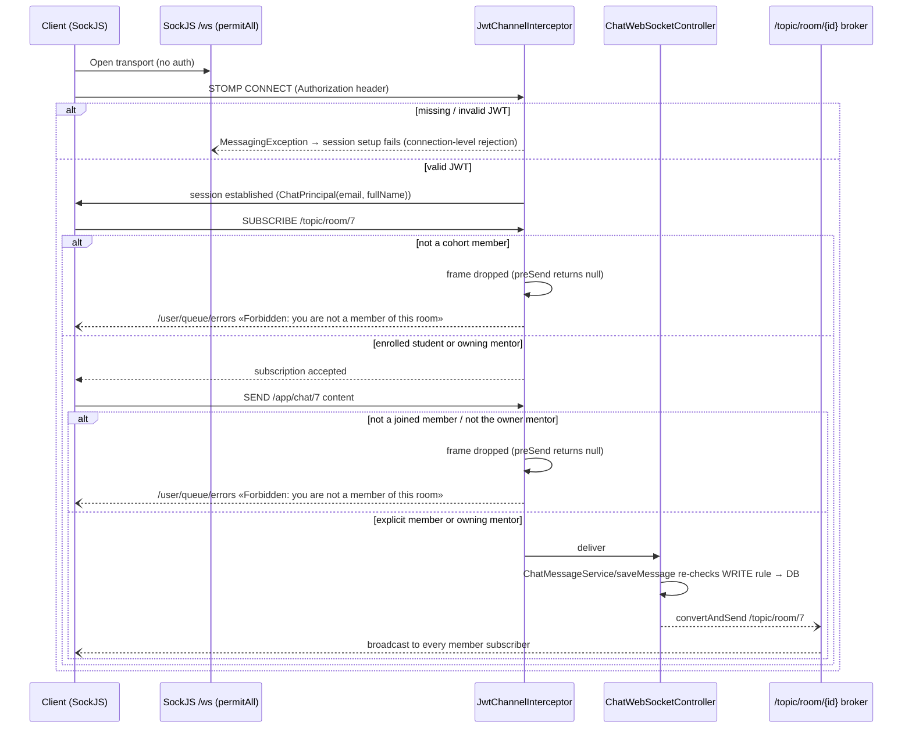

# WebSocket Connection Lifecycle & Authorization

Verified walkthrough of `config/webSocket/` with exact line citations. The key deliverable of this document: **which authorization checks exist vs are disabled**, and the resulting exposure.

## 1. Endpoints & transports

- `WebSocketConfig#registerStompEndpoints` (lines 34–38): **`/ws`**, `setAllowedOriginPatterns("*")`, `.withSockJS()` (XHR-family fallback transports included).
- HTTP path `/ws/**` is `permitAll` in both security profiles — **no HTTP-side auth** before the STOMP session starts.

## 2. Handshake phase — interceptor removed (P1-12 / EB-19)

The handshake layer has **no HTTP-side auth by design**: `/ws` is `permitAll` and the STOMP CONNECT command is the single authentication point. A `JwtHandshakeInterceptor` (query-parameter `?Authorization=<jwt>`) once existed as a `@Component` but was **never registered by `WebSocketConfig`** — verified dead code — and was **deleted outright by EB-19** (2026-10-31). Consequence (unchanged behavior, now explicit): SockJS fallback transports cannot set native STOMP headers, so they **cannot authenticate** — the frontend must use the native WebSocket transport. Raising a query-param handshake back from the dead is NOT an option (it leaks tokens into access logs); a fallback design would need a short-lived single-use ticket (see open questions in [MDS.md](MDS.md)).

## 3. STOMP frame phases (`JwtChannelInterceptor.preSend`)

| Command | What runs today | State |
|---|---|---|
| **CONNECT** | Requires native header `Authorization` (raw JWT, no `Bearer ` prefix). On success: `accessor.setUser(new ChatPrincipal(email, fullName))`. Missing/invalid token → `MessagingException` ( connection rejected) | ✅ active |
| **SUBSCRIBE** | Guards: `user == null` → frame dropped; null destination ignored. **`/topic/room/{id}` enforced by the D-14 READ rule** via `ChatAuthorization#canReadRoom` (`AuthorizationRepository#isUserMemberOfChatRoom`: enrolled student or owning mentor) — violations: frame DROPPED + authored error pushed to the violator's `/user/{email}/queue/errors` (P1-12 / EB-19; contract verified on real sockets by P2-05 / EB-39) | ✅ active |
| **SEND** | Guards: `user == null`; for `/app/chat/{roomId}` the **D-14 WRITE rule** runs via `ChatAuthorization#canWriteRoom` (explicit `chat_room_members` row or the room's owning mentor) — violations: frame DROPPED + authored error on `/user/{email}/queue/errors` (P1-12 / EB-19; wire-proven by P2-05 / EB-39). `/app/chat.private` needs an authenticated user only; the sender↔recipient pair is validated in `ConversationService` | ✅ active |
| **DISCONNECT** | SLF4J `debug` log of the disconnecting principal (`JwtChannelInterceptor`, P1-12 / EB-19 removed the `System.out`) | debug only |

Notes:
- **Rules are centralized in `service/chat/ChatAuthorization`** (P1-12 / EB-19): one component answers READ/WRITE/PRIVATE for every chat surface, reused by the interceptor and by `ChatMessageService#saveMessage` (defense in depth). The former three inconsistent membership semantics (TD-08 / G13) are collapsed into the two D-14 rules.
- Multiple concurrent sessions per account remain allowed (the single-session `connectedUsers` map was never built; its commented remnants were deleted by EB-19).
- `isTokenValid` (`service/jwt/JwtService`) checks signature+expiry only — **no enabled/deleted re-check at CONNECT**, unlike the HTTP validator filter. A token issued before deactivation stays usable for the full 7 days on the WS surface.
- `extractRoomId` parses the trailing path segment (`lastIndexOf('/')+1`); non-numeric ids are rejected (`MessagingException "Invalid destination format"`).

## 4. Dead-code trap — resolved (P1-12 / EB-19)

The commented blocks referenced `chatRoomRepository.isUserInRoom(email, roomId)` — a method that **never existed**, so the guard could not have been re-enabled as written. EB-19 (2026-10-31) removed the commented stubs and built the real guards instead of resurrecting them: a new **`ChatAuthorization`** component (`service/chat`) centralizes the rules, reusing `AuthorizationRepository#isUserMemberOfChatRoom` (enrollment-based READ) and adding `ChatRoomRepository#isRoomOwnedByMentor` + explicit `ChatRoomMember` membership (WRITE).

## 5. What any authenticated user can do today (exposure statement — post EB-19)

Since EB-19 the room surfaces are gated; what remains reachable with any valid JWT is:

1. ~~Subscribe/send into any cohort room~~ — **closed by EB-19**: SUBSCRIBE/SEND require mentorship membership per D-14.
2. **Private conversations to any user** (`/app/chat.private`) — get-or-create `Conversation` lets any enabled user message any registered user (product-level reach, not an IDOR); the sender↔recipient *pair shape* is validated, the client-controlled event *routing* of REST edit/delete pushes to a client-supplied `recipientEmail` queue remains open under **CHAT-04 / P1-13** ([messaging-flow.md §3](messaging-flow.md)).
3. CONNECT does not re-check `enabled`/`deleted` (unlike the HTTP validator filter) — a token issued before deactivation remains usable on the WS surface for its 7-day lifetime (SEL-06 row).

## 6. Connection lifecycle summary (mermaid)

## 7. Guards *ahead of the WebSocket surface*

- `REST` chat-history reads (`/api/v1/chat-room/{roomId}/messages`, members) **do** check membership — via `SecurityService.isUserMemberOfChatRoom` → `AuthorizationRepository.isUserMemberOfChatRoom` (lines 82–93) which matches **mentorship enrollment or the mentorship's mentor**, not explicit room membership ([messaging-flow.md §2.2](messaging-flow.md#2-membership-semantics-three-different-rules)).
- Room creation/deletion/image: mentor role + creator check.
- `joinRoom`: rejects already-joined and requires student enrollment in the room's mentorship (`ChatRoomService` lines 81–106 → `EnrollmentRepository.isUserInRoomMentorship`).

## 8. Testing recommendations

1. Integration: CONNECT with invalid/expired/disabled-user token is rejected.
2. Integration (post-fix): subscribe/send to a room the principal does not belong to → rejected frame + no DB row.
3. Unit: `extractRoomId` malformed destinations.
4. Contract test: SockJS fallback transport CONNECT behavior (opaque failure today).
