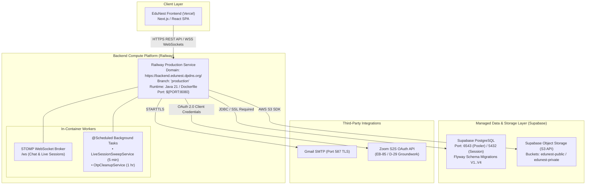

# Environment & Infrastructure Matrix (D-22 Ratification)

**Document Reference:** `ops/environments.md`  
**Task Anchor:** [`P6-01`](../plan/phases/phase-06-environment-and-deployment-automation/tasks.md#p6-01) (`EB-72`)  
**Decisions & Issues:** `D-22` (Hosting & environments), `DEP-07` (Environment definition), `DEP-03` (Storage), `R14` (WS/Scheduler validation)  
**Ratified By:** Omar Medhat (Tech Lead / Product Owner)  
**Date Ratified:** 2026-11-06  

---

## 1. Executive Summary & Topology Overview

EduNest operates as a containerized Spring Boot 3 monolith running on Java 21, coupled with a managed PostgreSQL database, S3-compatible cloud object storage, and a decoupled Next.js/React frontend.

To prevent frequent redeployments during active iterative development on `main`, continuous deployment is decoupled using a dedicated **`production`** branch:
* Active feature and fix development merges into `main` after pull request approval.
* Production deployments trigger only when changes are promoted from `main` into the **`production`** branch.



---

## 2. Environment Matrix

| Dimension | Local Development (`dev`) | Staging / PR Preview | Production (`prod`) |
| :--- | :--- | :--- | :--- |
| **Target Host** | Local Workstation (CLI / IDE / Docker) | Railway Staging / Ephemeral PR Environment | **Railway** (Primary) |
| **Custom Domain** | `localhost:8080` | `staging-backend.edunest.dpdns.org` (or Railway URL) | **`https://backend.edunest.dpdns.org/`** |
| **Source Branch** | Feature branches (`feat/*`, `fix/*`) | `main` | **`production`** (Promoted releases) |
| **Deployment Mode** | `mvnw spring-boot:run` or local Docker | Automatic Railway PR build | Automatic Railway trigger on push to `production` |
| **Spring Profile** | `dev` (`application.properties`) | `prod` (`application-prod.properties`) | `prod` (`application-prod.properties`) |
| **Database Engine** | Local PostgreSQL 16 (or Docker) | Supabase Staging PostgreSQL | **Supabase Production PostgreSQL** |
| **DB Port / Protocol**| `5432` / JDBC | `6543` (Pooler) / `5432` / JDBC + SSL | `6543` (Pooler) / `5432` / JDBC + SSL |
| **Schema Tool** | Flyway (`validate` + auto-migrate) | Flyway (`clean-disabled=true`, `validate`) | Flyway (`clean-disabled=true`, `validate`) |
| **Object Storage** | Local filesystem (`uploads/`) | Supabase S3 (test buckets) | **Supabase S3** (`edunest-public`, `edunest-private`) |
| **WebSocket Mode** | STOMP over SockJS (`/ws`) | STOMP (`wss://.../ws`) | STOMP (`wss://backend.edunest.dpdns.org/ws`) |
| **Scheduler Engine** | In-memory `@Scheduled` | In-memory `@Scheduled` (24/7 container) | In-memory `@Scheduled` (24/7 container) |
| **TLS / SSL** | Self-signed / Plain HTTP | Managed Automated TLS (Let's Encrypt / Railway) | **Managed Automated TLS (Railway custom domain)** |

---

## 3. Platform Evaluation & Documented Fallbacks

While **Railway** is the active production host for the container, contingency configurations are documented below in accordance with `D-22` and `tasks.md#p6-01`:

### 3.1 Primary Host: Railway
* **Why Selected:** Natively runs long-lived OCI/Docker containers without serverless cold-starts or socket timeouts.
* **WebSocket Reliability:** Supports persistent bidirectional TCP/WebSocket connections (`wss://`) without arbitrary 5-minute connection cutoffs. Spring Boot's in-memory `SimpleBroker` operates reliably for all connected clients.
* **Background Schedulers:** The container runs 24/7, allowing Spring's `@Scheduled` tasks (`LiveSessionSweepService` 5-min auto-close sweeps and `OtpCleanupService` hourly purge) to execute predictably.
* **Domain Binding:** Custom domain `backend.edunest.dpdns.org` mapped via CNAME to Railway's routing edge with automatic Let's Encrypt TLS certificate provisioning.

### 3.2 Secondary Fallback: Render (Free Web Service)
* **Configuration:** Docker Web Service running on Free Instance Type (512 MB RAM, 0.1 vCPU).
* **Cost / Credit Card:** 100% Free, **no credit card required** for signup or operation.
* **Keep-Alive Requirement:** Render free instances spin down after 15 minutes of zero inbound traffic. To maintain 24/7 execution for `@Scheduled` tasks and eliminate cold-starts, a free external pinging monitor (e.g., [UptimeRobot](https://uptimerobot.com) or [cron-job.org](https://cron-job.org)) is configured to ping `GET /swagger-ui/index.html` every 10 minutes.
* **Allowance:** Render grants 750 free instance hours per month; one container running 24/7 consumes 744 hours ($31 \times 24$), remaining completely within the free tier.

### 3.3 Tertiary Fallback: Vercel (Container Runtime / Fluid Compute)
* **Configuration:** Multi-stage `Dockerfile.vercel` using `framework: "container"`.
* **Cost / Credit Card:** 100% Free on Hobby plan, no credit card required.
* **Constraints & Mitigations:**
  1. *WebSocket 5-Minute Limit:* Vercel Hobby caps WebSocket duration at 300 seconds. Frontend STOMP client must configure automatic reconnection (`reconnectDelay: 3000`).
  2. *Serverless Idle Scaling:* Container scales to zero when traffic stops, pausing in-memory `@Scheduled` threads. Mitigated by creating an internal HTTP maintenance endpoint triggered via Vercel Cron or external scheduled webhook.
  3. *In-Memory Broker Drift:* Multi-instance autoscaling requires external Redis broker relay (`enableStompBrokerRelay`) to prevent dropped messages across instances.

---

## 4. Environment Variables & Secrets Catalog

All variables conform to the canonical template in `.env.example`. In production, secrets are injected via the Railway environment dashboard and are **never** committed to git or baked into Docker images.

| Variable Name | Required | Default / Example | Purpose & Sensitivity |
| :--- | :---: | :--- | :--- |
| `PORT` | Optional | `8080` | Port for embedded Tomcat. Dynamically supplied by Railway/Render. |
| `SPRING_PROFILES_ACTIVE` | **Required** | `prod` | Profile selector. `prod` activates hardened security chain & Flyway validation. |
| `APP_AUTH_RETURN_TOKEN_IN_BODY`| Optional | `true` | Transitional compatibility flag for JWT response format. |
| `DATABASE_URL` | **Required** | `jdbc:postgresql://<host>:6543/postgres?sslmode=require` | PostgreSQL JDBC connection URL. |
| `DATABASE_NAME` | **Required** | `postgres` (or `postgres.<ref>`) | Maps to `spring.datasource.username`. |
| `DATABASE_PASSWORD` | **Required** | `[SECRET]` | PostgreSQL database password (**High Sensitivity**). |
| `JWT_SECRET` | **Required** | `[32+ Char Secret]` | HS256 HMAC secret key (**Critical Sensitivity**). Fails fast if weak or missing. |
| `APP_COMMISSION_DEFAULT` | Optional | `10.0` | Default platform commission percentage for initial Flyway seed V4. |
| `MAIL_HOST` | **Required** | `smtp.gmail.com` | SMTP host for registration and OTP emails. |
| `MAIL_PORT` | **Required** | `587` | SMTP port (STARTTLS). |
| `MAIL_USERNAME` | **Required** | `[EMAIL]` | SMTP username / sender address. |
| `MAIL_PASSWORD` | **Required** | `[APP-PASSWORD]` | SMTP app-specific password (**High Sensitivity**). |
| `ZOOM_ENABLED` | Optional | `false` | Master switch for Zoom Server-to-Server OAuth integration. |
| `ZOOM_ACCOUNT_ID` | Optional | `[ACCOUNT-ID]` | Zoom Marketplace Account ID. |
| `ZOOM_CLIENT_ID` | Optional | `[CLIENT-ID]` | Zoom Marketplace Client ID. |
| `ZOOM_CLIENT_SECRET` | Optional | `[CLIENT-SECRET]` | Zoom Marketplace Client Secret (**High Sensitivity**). |
| `ZOOM_BASE_URL` | Optional | `https://api.zoom.us/v2` | Base URL for Zoom REST API. |
| `SUPABASE_STORAGE_ENABLED` | Optional | `false` | Master switch for Supabase S3 file storage. |
| `SUPABASE_URL` | Optional | `https://ciogysvcykzxrjuskxmk.supabase.co` | Supabase project URL. |
| `SUPABASE_S3_ENDPOINT` | Optional | `https://ciogysvcykzxrjuskxmk.storage.supabase.co/storage/v1/s3` | S3-compatible storage endpoint. |
| `SUPABASE_S3_REGION` | Optional | `eu-west-1` | S3 region identifier. |
| `SUPABASE_S3_ACCESS_KEY` | Optional | `[ACCESS-KEY]` | S3 access key ID (**High Sensitivity**). |
| `SUPABASE_S3_SECRET_KEY` | Optional | `[SECRET-KEY]` | S3 secret access key (**High Sensitivity**). |
| `SUPABASE_STORAGE_PUBLIC_BUCKET` | Optional | `edunest-public` | Public bucket name (avatars, course thumbnails). |
| `SUPABASE_STORAGE_PRIVATE_BUCKET`| Optional | `edunest-private` | Private bucket name (student task submissions). |
| `APP_LIVESESSION_AUTO_CLOSE_ENABLED` | Optional | `true` | Enables background sweep for abandoned live sessions. |
| `APP_LIVESESSION_AUTO_CLOSE_SWEEP_RATE_MS` | Optional | `300000` | Sweep execution interval in milliseconds (default: 5 min). |
| `APP_ZOOM_HOST_USER_ID` | Optional | `me` | Zoom host account id (`me` = API plan owner) for meeting creation (EB-66). |
| `APP_ZOOM_MAX_MEETING_MINUTES` | Optional | `40` | Meeting-length hard cap (Zoom Basic plan). |
| `APP_ZOOM_OAUTH_TOKEN_URL` | Optional | `https://zoom.us/oauth/token` | S2S OAuth token endpoint override. |
| `APP_LIVESESSION_AUTO_CLOSE_GRACE_MINUTES` | Optional | `10` | Grace period before the auto-close sweep ends/cancels sessions (EB-57 / D-15). |
| `APP_LIVESESSION_AUTO_CLOSE_MAX_DURATION_MINUTES` | Optional | `40` | Max nominal session duration used by the sweep. |
| `APP_LIVESESSION_ATTENDANCE_ENFORCED` | Optional | `false` | **Dormant** per D-15: attendance enforcement master switch. |
| `APP_LIVESESSION_ATTENDANCE_PASS_THRESHOLD` | Optional | `75` | Dormant: pass threshold %. |
| `APP_LIVESESSION_ATTENDANCE_SNAPSHOT_GRID_MINUTES` | Optional | `5` | Dormant: snapshot grid step. |
| `APP_LIVESESSION_ATTENDANCE_BONUS_POINTS` | Optional | `5` | Dormant: gamification bonus (no-op while dormant). |
| `APP_LIVESESSION_ATTENDANCE_ABSENCE_FLOOR` | Optional | `0` | Dormant: absence penalty floor. |
| `EDUNEST_UNSAFE_DEV` | Dev-only | `false` | **DEV ONLY, never in staging/prod** (SEL-02): the app refuses to boot without either `prod` profile or this flag `true`; activates the insecure permissive dev chain. |
| `APP_RATE_LIMIT_ENABLED` | Optional | `true` | Auth throttling/lockout master switch (EB-15); per-bucket overrides resolvable via relaxed binding. |
| `APP_UPLOAD_BASE_DIR` | Optional | `uploads` | Local-disk upload root (active when Supabase storage is disabled). |
| `APP_AUTH_RESET_TOKEN_TTL` | Optional | `PT5M` | Password-reset token lifetime (ISO-8601 duration). |
| `APP_CERTIFICATE_ISSUANCE_BATCH_SIZE` | Optional | `100` | Certificate issuance snapshot batch size (clamped 1..1000; EB-54). |

> CORS is **not** env-configurable: allowed origins/methods are fixed to `*` in both security chains (`ProjectSecurityConfig`) — recorded as configuration debt for P6-03 review.

---

## 5. Branch & Continuous Deployment Strategy

```mermaid
gitGraph
    commit id: "Initial"
    branch feat/feature-x
    checkout feat/feature-x
    commit id: "Dev Work"
    commit id: "Unit Tests"
    checkout main
    merge feat/feature-x id: "PR Merge (#85)"
    commit id: "main (CI Green)"
    checkout production
    merge main id: "Promote to Prod"
    commit id: "Railway Deploy (https://backend.edunest.dpdns.org/)"
```

1. **`main` Branch (Integration)**:
   - All merged pull requests land on `main`.
   - CI runs Maven test suite, SpotBugs check, and security dependency verification.
   - Deployments are NOT triggered to production on every commit, preventing unwanted service restarts and deployment budget exhaustion.
2. **`production` Branch (Release Gate)**:
   - Railway is configured to track and deploy exclusively from the **`production`** branch.
   - When a release milestone or sprint is ready for deployment, `main` is merged/promoted to `production` via fast-forward or release PR.
   - Railway triggers automated Docker build and rolling deployment with zero downtime.

---

## 6. Secret Management & Injection Policy

1. **Zero Secret Storage in Git:**
   - Secrets (`DATABASE_PASSWORD`, `JWT_SECRET`, `MAIL_PASSWORD`, `ZOOM_CLIENT_SECRET`, `SUPABASE_S3_SECRET_KEY`) must NEVER appear in repository files, commits, or Docker build layers.
   - `.env.example` contains only non-sensitive templates and structure documentation.
2. **Fail-Fast Boot Safeguards:**
   - `JwtSecretProvider` asserts `JWT_SECRET` presence, length ($\ge 32$ bytes), and non-default status on application startup. If invalid, the JVM immediately terminates with an explanatory error.
   - Spring Boot datasource validation ensures immediate startup termination if database connectivity or credentials fail.
3. **Secret Rotation Procedure:**
   - **JWT Secret:** Generate a new 256-bit secret string $\to$ update Railway environment variable $\to$ restart container. (Existing user sessions will expire and require re-authentication).
   - **Database Password:** Update password in Supabase dashboard $\to$ update `DATABASE_PASSWORD` in Railway $\to$ restart container.
   - **Storage / Zoom Keys:** Update API keys in respective vendor consoles $\to$ update Railway variables $\to$ restart container.

---

## 7. Operational Runbook & Health Checks

### 7.1 Production Health Verification
* **Public Swagger UI / Docs:** `https://backend.edunest.dpdns.org/swagger-ui/index.html`
* **API Documentation (JSON):** `https://backend.edunest.dpdns.org/v3/api-docs`
* **WebSocket STOMP Handshake:** `wss://backend.edunest.dpdns.org/ws` (SockJS info: `https://backend.edunest.dpdns.org/ws/info`)

### 7.2 Database Backups & Recovery
* **Automated Daily Snapshots:** Handled natively by Supabase with 7-day retention on free tier.
* **Disposable Migration Rehearsal:** All schema changes must pass the automated disposable PostgreSQL rehearsal test (`UniquenessPostgresMigrationIT` / `ops/rehearsals/Invoke-MigrationRehearsal.ps1`) before deployment.
* **Rollback Standard:** Database migrations are strictly **forward-only**. In the event of an issue, a roll-forward Flyway script (`V{N+1}__...sql`) must be applied.

---

## 8. Stakeholder Approval Record

* **Architecture Decision:** `D-22` ratified with Railway as primary host and custom domain `https://backend.edunest.dpdns.org/`.
* **Approver:** Omar Medhat (`mr.omarmedhat@gmail.com`)
* **Approval Status:** **APPROVED**
* **Target Delivery:** `P6-01` (`EB-72`)
