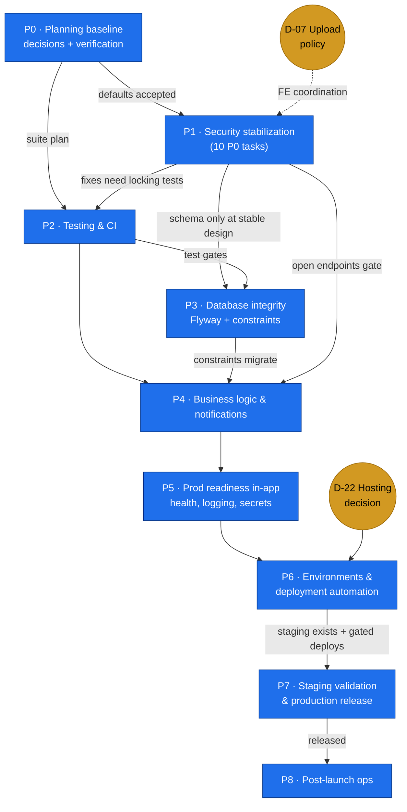

# ROADMAP — From Audited Codebase to Verified Production Release

98 planned tasks across **9 phases** (Phase 0 → Phase 8). Priority totals: **P0 = 13**, **P1 = 50**, **P2 = 33**, **P3 = 2**. Full per-issue traceability: [`ISSUE-MAPPING.md`](ISSUE-MAPPING.md).

## 1. Phase overview

| Phase | Name | Objective | Tasks | Key entry requirement | Key exit artifact |
|---|---|---|---|---|---|
| 00 | [Planning baseline & decisions](phases/phase-00-planning-baseline/MDS.md) | Verify suspected findings; unblock decisions; fix working agreements | 9 | This plan accepted | Decision register round 1 + verified/rejected suspections recorded |
| 01 | [Security stabilization](phases/phase-01-security-stabilization/MDS.md) | Close every Critical/High exploit path; harden auth, authorization, uploads, chat | 27 (10×P0) | Phase 0 defaults accepted | All P0 security tasks verified by tests |
| 02 | [Testing & CI](phases/phase-02-testing-and-ci/MDS.md) | Testcontainers suite + CI that cannot skip tests; regression net over Phase 1 fixes | 8 | Phase 1 fixes landing | Green CI pipeline gating `develop`/`main` |
| 03 | [Database integrity](phases/phase-03-database-integrity/MDS.md) | Flyway baseline; uniqueness constraints; transactional correctness | 7 | Phase 2 CI green | Versioned migrations replace `ddl-auto=update` in prod |
| 04 | [Business logic & notifications](phases/phase-04-business-logic-and-notifications/MDS.md) | Points/certificates consistency, notification timing, stats correctness, perf debt | 17 | Phase 0 product decisions (D-08..D-15) | Business rules implemented per decisions with tests |
| 05 | [Production readiness (in-app)](phases/phase-05-production-readiness/MDS.md) | Health checks, logging, secrets wiring, rate limits, docs parity | 5 | Phase 4 core merged | App is operable & observable in prod profile |
| 06 | [Environments & deployment automation](phases/phase-06-environment-and-deployment-automation/MDS.md) | Provision staging/prod, CI/CD stages, volumes, secrets management | 9 | D-22 hosting decision | Repeatable, gated deploys to staging |
| 07 | [Staging & release](phases/phase-07-staging-and-release/MDS.md) | Validate on staging; go/no-go; execute & verify production release | 8 | Phase 5+6 complete + staging provisioned | Signed production release + verified post-deploy checks |
| 08 | [Post-launch operations](phases/phase-08-post-launch-operations/MDS.md) | Monitoring/alerting, incident response, backups drills, triage cadence | 8 | Production release live | Operations runbook + stabilization gate passed |

Closest analogue to "Phase 0" from the proposal framework is covered by phase-00 plus the standing decision register; Phases 6–8 exist because **deployment, release, rollback and post-launch operation are explicitly out of scope of "in-app production readiness" (Phase 5)**.

## 2. Dependency graph



**Startable immediately (day 1), independent of decisions:** P2-01 (test scaffolding), P2-07 (CI pipeline), P1-01/P1-02 (secret + fail-fast — technical, no product dependency), P0-03..P0-09 (verification of suspected findings).

## 3. Critical path (shortest chain to a safe production release)

1. **P0-02** — decision round 1: D-01 (session model), D-05 (open endpoints), D-07 (upload policy), **D-22 (hosting)**, D-23 (CORS) — nothing infra-related moves without D-22.
2. **P1 P0 set** — P1-01 (secret) must precede **P6-03** (prod secret provisioning) *in this exact order*: rotate-before-fix breaks login (see [RISKS §2](RISKS-AND-DEPENDENCIES.md#2-top-risks)).
3. **P1-12 (WS authorization)** and **P1-21 (upload exposure)** — the two architectural security fixes with frontend coordination; both gate P7-02 (staging E2E).
4. **P2-07 + P2-03** — CI + authorization regression suite: the merge gate for everything after.
5. **P3-01** — Flyway baseline; gates P6-04's deploy logic (migrations must run in pipeline).
6. **P5-01/P5-02** — health + logging: gate P7-04 (observability validation) and the production runbook.
7. **P6-02 → P6-04 → P7-01 → P7-02 → P7-03** — staging exists → gated deploys → validated.
8. **P7-05 (go/no-go) → P7-06 (release execution) → P7-07 (post-deploy verification)** → Phase 8 stabilization gate.

Anything off this path can progress in parallel or slip without delaying launch, provided its own dependencies are met (see §4).

> Ordering guarantee: no phase's exit criteria reference an artifact that a preceding phase on the path hasn't produced. Where tasks could run earlier, the task's "Depends on" field governs, not the phase number.

## 4. Parallel workstreams

| Stream | Participants | Runs | Guardrail |
|---|---|---|---|
| **A — Security code** | 2 Backend Dev + Security Reviewer | P1 tasks (P1-01…P1-27), P4-02/03 | Config files (`ProjectSecurityProdconfig`, filters) are single-owner-per-day; see [TEAM-WORKFLOW §7](TEAM-WORKFLOW.md#7-conflict-avoidance-rules-for-shared-files) |
| **B — Test/CI foundation** | 1 Backend Dev + QA | P2-01/02/07 immediately; then suites | Can merge before CI exists (review-gated), CI becomes mandatory gate at P2-07 |
| **C — Database** | 1 Backend Dev + DevOps support | P3 after P1 content-guards settle; migrations rehearsed in P3-07 | One migration author per day (naming convention in P3-01) |
| **D — Product decisions & verification** | PO + QA + FE liaison | P0 continuously; decisions D-08…D-15 before P4 tasks start | Verification results feed back into `mds/ISSUES.md` (sync rule) |
| **E — Infra/DevOps** | DevOps | D-22 → P6-*; overlaps Phases 3–5 | D-22 is the only hard blocker on this stream |
| **F — Release/ops prep** | QA + DevOps + Eng Lead | P7/P8 docs & runbooks written while C/D execute | Execution waits for phase exits |

## 5. Conditional and deferred work (explicit, not forgotten)

| Conditions / Deferrals | Issue(s) | Task | Trigger / default |
|---|---|---|---|
| Session invalidation & logout | SEL-06 | P1-27 (conditional) | D-01; default = short-lived access + refresh |
| Chat receipts/unread | CHAT-07 | P4-07 (conditional) | D-13; may defer to post-launch |
| `passPoints` unlock feature | LEARN-08 | P4-15 (conditional) | D-10; default = remove claim & field |
| Certificate PDF rendering | CERT-01 | P5-05 (docs) + optional feature | D-11; default = update claims, defer feature |
| Jitsi JWT protection | LS-01 | P4-17 (conditional) | D-16; default = public rooms + truthful docs |
| Object storage for uploads | FILE-07 | P6-07 (conditional) | D-25; default = Docker volume first |
| API envelope/path standardization | API-01, API-03 | P4-16 (conditional) | D-20; expected deferral (breaking-change cost) |
| WS token-in-URL latent design | SEL-13 | — | Deferred; only revisits if dead interceptor is ever re-enabled |
| Naming refactor (TD-01) | TD-01 | — | Deferred (`risk > value` mid-stabilization) |

## 6. Release lifecycle (end-to-end view)

```
Audited codebase (today)
   │  Phases 0–2: security closes, CI proves it
   │  Phases 3–4: data + business logic consistent
   │  Phases 5–6: app operable, environments provisioned, deploys gated
   ▼
Staging (P7-01) → E2E + security validation (P7-02/03/04) → Go/No-Go (P7-05)
   ▼
Production release runbook (P7-06): backup → migrate → deploy → verify (P7-07) → comms (P7-08)
   ▼
Post-launch: observation period, monitoring, drills, triage (P8) → stabilization gate exit
```

Measurable release & go/no-go criteria: [`phases/phase-07-staging-and-release/acceptance-criteria.md`](phases/phase-07-staging-and-release/acceptance-criteria.md) §3–§4.

## 7. Effort profile (T-shirt summary, no calendar claims)

Phase 1 carries the largest volume (27 tasks: ~4L, ~10M, ~9S, ~4XS-equivalent) and must not be compressed below its review requirements. Phases 2–4 are heavy but parallelizable across streams A/B/C. Phases 6–8 are infrequent-activity phases: each task is small-to-medium but gates on external availability (D-22, credentials, DNS/TLS), not on developer hours.

## 8. Decision status log

### 2026-10-25 — first decision round (user-approved)

| Decision | Outcome | Effect on the roadmap |
|---|---|---|
| D-05 | Delete test push/mail endpoints (not admin-gate) | P1-11 re-scoped to "delete"; addendum **[ADD-04]** created (test-endpoint inventory) |
| D-07 | Uploads → **Supabase Storage (S3)**, bucket policies + ownership checks (security intent of (a) preserved) | P1-21 re-scoped; P6-07 superseded by **[ADD-03]** |
| D-14 | WS fix **approved** (status quo rejected) | P1-12 unblocked; WS hardening hooks added |
| D-22 | App = container · DB = **Supabase Postgres** · files = Supabase Storage S3 | Infra stream unblocked; A-4 superseded; **[ADD-01]**, **[ADD-02]** created |
| D-25 | Object storage **now** (Supabase), not volume-first | P6-05 loses its uploads volume; P6-07 superseded |
| D-16 | **Zoom replaces Jitsi** for live sessions/meetings | P4-17 re-scoped to Zoom integration; **[ADD-05]** provisions the Zoom app; docs-parity (DOC-01/P5-05) claims corrected toward Zoom; LS-01 exposure narrows via Zoom-native controls |

**Critical-path amendment:** readiness phase 6 is no longer decision-gated, but a new fork precedes `P3-01`:
**[ADD-01]** adopt Supabase Postgres → **[ADD-02]** MySQL→Postgres migration → **P3-01** (Flyway baseline must now be captured on Postgres). Risk **R13** added for this chain. Task-level execution is tracked in Jira project **EB** (EB-1..EB-84; addenda EB-81..EB-84).
