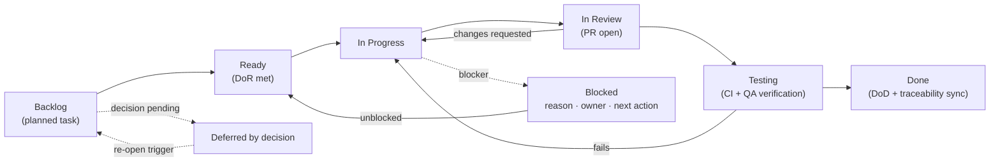

# Team Workflow — How the Plan Gets Executed

Lightweight Agile flow for a small team using the approved main-only workflow. Nothing here assumes Jira or any specific tool exists — §9 maps this model onto Jira *if* the team adopts it.

## 1. Cadence and ceremonies (no capacity or dates invented)

| Ceremony | Suggested rhythm | Content |
|---|---|---|
| Iteration planning | Weekly, 1-week iterations | Pull top-of-board tasks per workstreams A–F ([ROADMAP §4](ROADMAP.md#4-parallel-workstreams)); commit to what fits *own* capacity — no velocity numbers |
| Decision review | 2× week, 15 min or async in writing | Advance [`DECISIONS-REQUIRED.md`](DECISIONS-REQUIRED.md); confirm defaults or pick options |
| Verification demo | Mid-week, 15 min | Show a verification result or test run; anyone may demo evidence |
| Phase sign-off review | On phase exit-criteria completion | Walk [`acceptance-criteria.md`](phases/phase-01-security-stabilization/acceptance-criteria.md) of the closing phase; record sign-off |
| Risk scan | Weekly, 5 min | Re-read [`RISKS-AND-DEPENDENCIES.md`](RISKS-AND-DEPENDENCIES.md) §2; update likelihood/impact if changed |

## 2. Execution model

Board columns = the six solid states. `Blocked` and `Deferred by decision` are states *on* tasks (shown on the card), not extra columns.

- **Backlog → Ready:** Definition of Ready (§5) met; task picked from a workstream, not randomly.
- **Ready → In Progress → In Review:** branch per §3; PR opened early as a draft if helpful.
- **In Review → Testing:** automatic CI checks + QA manual verification when the task declares manual validation (typical for infra/staging tasks in Phases 6–7).
- **Testing → Done:** acceptance criteria checked with evidence links + traceability sync (§6). **A task is never Done on review approval alone.**

## 3. Branching and PR model

- `main` — the protected integration and release branch. Direct pushes are prohibited; task changes enter through PRs targeting `main`, after required CI checks and reviewer approvals. Release tags are created only according to the [P7-06 release runbook](phases/phase-07-staging-and-release/tasks.md#p7-06).
- `develop` is obsolete and is not an active integration branch.
- Fetch the latest `origin/main` and create every task branch from it. One task = one branch = one PR targeting `main`.
- **Task branches:** replace the current name-branch habit with `feat/P1-12-ws-room-authz`, `fix/P1-09-admin-hash-leak`, `chore/P1-26-dead-deps`, `docs/P7-08-release-notes`, `ops/P6-05-docker-hardening`, `test/P2-03-authz-suite`, `decision/*` not needed. One task = one branch = one PR.
- Rebase on the latest `origin/main` before requesting review; keep PRs single-purpose (giant mixed PRs are the main risk to review quality here).
- Hotfix lane defined in [P8-06](phases/phase-08-post-launch-operations/tasks.md#p8-06): branches `hotfix/...` start from the latest `origin/main`, target `main` via PR, and must pass the *full* required checks and reviews.

**PR requirements:**
1. Title starts with the task ID (`P1-12: …`).
2. Body: task link, issue IDs, *what changed & why*, risk notes, **test evidence** (commands run + result, or CI run link), docs/traceability checklist.
3. Diff size guidance ≤ ~400 LOC excluding migrations/generated files (larger = pre-announce and split PRs where feasible).
4. Checklist masks: [ ] tests added/updated [ ] `mds/` docs touched where behavior is documented [ ] `ISSUE-MAPPING.md` row updated [ ] security-review checkbox if trigger applies.

## 4. Review process

- **Code review:** every PR needs 1 approval; PRs marked *risk: high* in the task record need 2.
- **Security review (distinct approval) is mandatory when a PR touches:** `config/security/**`, `config/webSocket/**`, `filters/**`, `service/jwt/**`, `service/auth/**` (OTP/reset), file services (`FileStorageService`, `ImageStorageService`, `FileAccessService`, `FileController`), rate-limit code, CORS, exception handler contract, or the upload URL policy.
- Security Reviewer checks against the invariants in the relevant [`domains/` doc](domains/authentication-security/MDS.md) (each domain doc has a "review checklist" subsection).
- Reviewer does not re-open settled decisions; changes-of-heart route back through [`DECISIONS-REQUIRED.md`](DECISIONS-REQUIRED.md).

## 5. Definition of Ready / Definition of Done

**DoR (before In Progress):**
1. Task has an ID, owner *role*, estimate, and dependencies either satisfied or consciously accepted in writing.
2. Any decision it depends on is **Decided** or its documented default confirmed by the PO (decisions never block silently — the task shows which).
3. For FE-visible changes: the coordination channel note exists (even if FE confirmation is pending — recorded on the task).

**DoD (before Done):**
1. Acceptance criteria in the task all checked, each with evidence (test name, CI run, staging URL, checklist row).
2. Tests required by the task exist and pass; no disabled/skipped tests (`@Disabled`/"skip") land on a required path.
3. `mds/` documentation updated where behavior contracts changed (API files, domain docs), or the PR states "no doc impact".
4. [`ISSUE-MAPPING.md`](ISSUE-MAPPING.md) row(s) moved to `Implemented, awaiting verification` → after QA/verification → `Verified`.
5. Phase-level acceptance file gains the evidence row.
6. Branch merged; task closed on the board.

## 6. Sync rules with the audit registry

- `mds/ISSUES.md` = **canonical defect truths**. Its issue rows are **not re-written to claim fixes** during execution. One-time setup action (first sync-performing PR): append under its header a single pointer line: *"Resolution tracking lives in `plan/ISSUE-MAPPING.md`; do not edit issue rows here."* Nothing else in ISSUES.md changes during stabilization.
- [`ISSUE-MAPPING.md`](ISSUE-MAPPING.md) is the live tracker: each execution PR sets its row to `In Progress → Await verification → Verified` with evidence links. Verification-task results (Phase 0) also update the row's disposition notes (confirmed/refuted + evidence), which then flow into the relevant implementation task.
- New defects discovered during implementation: **add a row to `mds/ISSUES.md`** using the next free ID in the issue's family (with evidence), then reference it from the plan task — never track a real defect only inside a PR description.
- Phase sign-off reviews assert that all mapped rows for that phase are `Verified` (or explicitly `Deferred by decision`/`Blocked` with entries in [`RISKS-AND-DEPENDENCIES.md`](RISKS-AND-DEPENDENCIES.md)).

## 7. Conflict-avoidance rules for shared files

| Shared artifact | Rule |
|---|---|
| `config/security/*`, `config/WebConfig`, `filters/*` | **Security-config steward** (role, one person at a time) owns merges into these; parallel PRs touching them rebase at the same time and land in sequence; security-review mandatory |
| Flyway migrations | One migration author per day; naming `V<seq>__<desc>.sql` with a reserved-numbers note at the top of the directory README section in [P3-01](phases/phase-03-database-integrity/tasks.md#p3-01); migrations never edited after merge (new `V` corrects) |
| `pom.xml` dependency changes | Only via tasks that name the dependency (P2-01, P3-01, P5-01, P1-27-conditional); PRs touching `pom.xml` ping the whole stream-A group |
| Cross-cutting services (`NotificationService`, `TotalPointsRepository`, `JwtService`, `EmailService`) | Announce in the stream channel *before* starting; single writer per file at a time; others queue |
| `mds/api/endpoints.md` & `error-responses.md` | Contract PRs include the doc update in the same PR |
| `plan/` traceability files | Updated within the same PR that implements the task (no orphan plan state) |

## 8. Blocked-task handling

Every `Blocked` task must show, at all times:
1. **Blocking reason** (decision `D-xx`, missing environment access, FE confirmation, infra credential…),
2. **Unblocking owner** (role from the task record),
3. **Next action** (the exact step to clear it),
4. Re-check entitlement: the weekly risk scan or the decision review must *state progress on every Blocked item* — silence on a Blocked task in any ceremony is an escalation to the Eng Lead (§10).

## 9. Jira-compatible mapping (optional adoption)

| Plan concept | Jira suggestion |
|---|---|
| Phase | Epic (summary `Phase 01 — Security stabilization`) |
| Task `P1-12` | Issue whose z-custom "Plan ID" field = `P1-12` (or prefix in summary) |
| Workstream (A–F) | Component (Security, Testing, Database, Product, Infra, Release) |
| Status flow | `To Do`=Backlog, `Selected for Dev`=Ready, `In Progress`, `In Review`, `QA/Test`=Testing, `Done` |
| Blocked | Flag + "Blocked on" text field containing reason/owner/next action |
| Deferred by decision | Status `On Hold` + link to the `D-xx` decision issue |
| Definition of Ready/Done | Jira automation checklist fields or Checklists plugin |

No existing Jira instance is assumed; adopting tooling is an ops-side choice recorded as an assumption in [`RISKS-AND-DEPENDENCIES.md` §6](RISKS-AND-DEPENDENCIES.md#6-planning-assumptions-register).

## 10. Progress reporting & phase sign-off

- **Weekly report** (owner: Eng Lead; template: [`templates/PROGRESS-REPORT-TEMPLATE.md`](templates/PROGRESS-REPORT-TEMPLATE.md)): tasks advanced by state, Blocked list with the §8 four fields, decisions advanced, verification results (evidence links), CI status, phase-entry/exit delta, risks updated.
- **Phase sign-off** (owner: Eng Lead + Security Reviewer + QA + PO): all phase acceptance criteria evidence-checked; sign-off table in the phase's `acceptance-criteria.md` filled with *names* at execution time (roles only here); unresolved items must be on the Blocked list or deferred via decision — a phase cannot "pre-approve" itself.
- **Definition of "verified":** evidence artifact exists (CI run for tests; recorded checklist entry for manual/infra checks) and is linked from the task row. Anything else is `Implemented, awaiting verification` — never `Done`.
